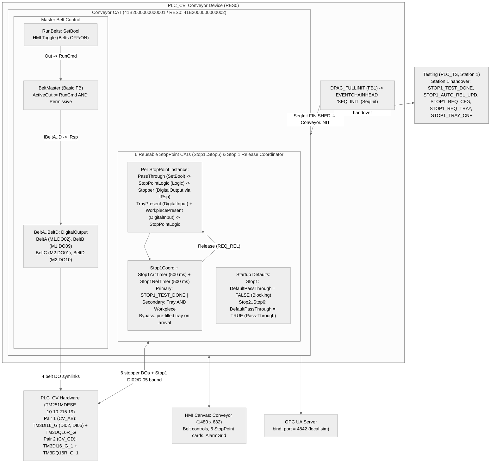

# Conveyor Subsystem — Implementation & Reference

| Property | Value |
| --- | --- |
| **Subsystem** | Main conveyor loop (`Conveyor A–D` belts and 6 station stop points `Stop1`–`Stop6` across Stations 1–6) |
| **CATs & Basic FBs** | [`Conveyor`](../nmps/IEC61499/Conveyor/Conveyor.fbt) CAT, [`StopPoint`](../nmps/IEC61499/StopPoint/StopPoint.fbt) CAT, [`BeltMaster`](../nmps/IEC61499/BeltMaster.fbt) Basic FB, [`StopPointLogic`](../nmps/IEC61499/StopPointLogic.fbt) Basic FB, [`Stop1Coord`](../nmps/IEC61499/Stop1Coord.fbt) Basic FB |
| **Solution / Device** | `nmps/nmps.sln` → `Conveyor` (`3787d19b-21b6-4484-a451-1bc349975489`, `SE.DPAC.M251_dPAC`, resource `RES0` `3C66F41FCD63075`) |
| **Controller & IP** | `PLC_CV` (`TM251MDESE`, `ETH1` `10.10.215.19`, `CV_AB` `TM3DI16_G` + `TM3DQ16R_G`, `CV_CD` `TM3DI16_G_1` + `TM3DQ16R_G_1`) — see [HARDWARE.md](HARDWARE.md) |
| **Libraries** | `SE.App2CommonProcess`, `SE.App2Base` (`25.0.1.5`); `Runtime.Base` (`25.0.1.2`); `SE.IoTMx` (`25.0.1.4`); `SE.DPAC` (`25.0.1.10`) |
| **HMI Canvas** | `Conveyor` (`1480 x 632` with `AlarmGrid`, [`Conveyor.cnv.cs`](../nmps/HMI/Conveyor.cnv.cs)) |
| **OPC UA / Sim Ports** | OPC UA `bind_port = 4842`; Local Simulation Deploy `51501`, Archive `51498`, `ReliableCrossComm` `udp://0.0.0.0:41502` |
| **Status** | All 4 belts + 6 stop points, Station 1 (`Testing` + `Distribution`) handover (`Stop1Coord`, `Stop1Pass`, pre-filled tray bypass), and 3-PLC OPC UA logging (`350` Conveyor vars / `82 KB`) verified on physical `PLC_CV`, `PLC_TS`, and `PLC_DS` |

---

## 1. Overview & Architecture Rationale

The Festo MPS 400 closed-loop transfer system circulates trays continuously past six station interfaces using **four independent conveyor belt segments** (two short corner/infeed belts and two long main-line belts) and **six pneumatic/solenoid stop points** (`Stop1`–`Stop6`). By default, all four belts start `OFF`, `Stop1` starts **Blocking** (holding the tray at Station 1 / Testing), and `Stop2`–`Stop6` start in **Pass-Through** mode so trays cycle directly back to Station 1 once released.

### Lightweight Architecture Choice

An earlier prototype (`conveyor-cat` branch) modeled only three stop points using heavier `SE.AppSequence` chains. Because `PLC_CV` is a Modicon M251 dPAC constrained to `MaxVariableNodes = 500` (~100 KB compiled `ecort_opcua_ns2.bin`; see [HARDWARE.md](HARDWARE.md#m251-dpac-opc-ua-resource-limits)), scaling `SE.AppSequence` across four belts and six full stop points would risk exhausting OPC UA variable capacity on a single controller.

To avoid that limit while preserving standard EAE faceplates, alarms, and per-actuator overrides, `Conveyor` uses a **lightweight pattern**:

1. **Standard library I/O blocks only:** Each belt and each stopper uses `SE.App2CommonProcess.DigitalOutput`, each sensor uses `SE.App2CommonProcess.DigitalInput`, and HMI toggle buttons use `SE.App2Base.SetBool`.
2. **Compact adapter-driving Basic FBs:** Two small Basic FBs — [`BeltMaster`](../nmps/IEC61499/BeltMaster.fbt) and [`StopPointLogic`](../nmps/IEC61499/StopPointLogic.fbt) — push setpoints via `SE.App2Base.IDigital` adapters into `DigitalOutput.IRsp`, matching Schneider Electric's AHU reference pattern.
3. **Program Remote + Operator override:** `DigitalOutput` blocks boot in `Program Remote` (`16#8`), obeying `BeltMaster` or `StopPointLogic`, while operators can switch any individual belt or stopper faceplate to `Operator` (`16#10`) for manual lab testing; returning to `Program` automatically re-synchronizes the remote setpoint via `REQ_FB` / `Track`.

---

## 2. Architecture & Design



*Figure 1. Architecture of the `Conveyor` subsystem, including live hardware links (`10 DO`s + `Stop1` `DI02`/`DI05`) and cross-PLC Station 1 handover wiring with `Testing`.*

- **System layout (`6176bcc6-dc42-44e0-920e-ad204ed015ce.syslay`):** In [`6176bcc6-dc42-44e0-920e-ad204ed015ce.syslay`](../nmps/IEC61499/System/0c9a2a54-81d8-4cd3-8b56-539d6ba31ede/9bf3b433-92e3-4d31-8cff-c20036297fe9/6176bcc6-dc42-44e0-920e-ad204ed015ce.syslay), the `Conveyor` CAT instance carries application FB ID `41B2000000000001` (`Mapping="41B2000000000001"` on `RES0`) and is wired to `Testing` (`248448E89426980E`) for Stop 1 tray/workpiece sensing and temporary release control.
- **Resource startup chain (`RES0`):** Inside [`3C66F41FCD63075.sysres`](../nmps/IEC61499/System/0c9a2a54-81d8-4cd3-8b56-539d6ba31ede/3787d19b-21b6-4484-a451-1bc349975489/3C66F41FCD63075.sysres), `START.COLD` and `START.WARM` initialize `FB1` (`SE.DPAC.DPAC_FULLINIT`), whose `INITO` initializes and triggers `SeqInit` (`Runtime.Standard.EVENTCHAINHEAD` with `$NAME = 'SEQ_INIT'`); `SeqInit.FINISHED` fires `Conveyor.INIT` (`D110000000000001`). `START.ONLINECHANGE` re-triggers the same chain via `OC_RETRIGGER` / `OC_DONE`. Inside `Conveyor`, `INIT` cascades sequentially through `BeltMaster.INIT` → `Stop1.INIT` → … → `Stop6.INIT` → `Conveyor.INITO`.
- **Device deployment properties:** [`F513CAE3-7194-4086-936C-02912EA0B352.Properties.xml`](../nmps/IEC61499/System/0c9a2a54-81d8-4cd3-8b56-539d6ba31ede/3787d19b-21b6-4484-a451-1bc349975489/F513CAE3-7194-4086-936C-02912EA0B352.Properties.xml) configures `ClearBeforeDeploy = True`, `AutoStart = True`, `BootMode = Run`, and `endpoints/0/bind_port = 4842`.

---

## 3. Hardware & I/O Mapping

For controller specifications, Ethernet addressing (`ETH1` `10.10.215.19`, `MAC` last bytes `D7:13`), and TM3 relay wiring rules, see [HARDWARE.md](HARDWARE.md).

### Why Many TM3 Output Channels Are Unused

`PLC_CV` hosts two alternating TM3 DI/DO pairs on `BMTM3` (`T#80ms` cycle time, relay outputs `TM3DQ16R_G`): **Pair 1 (`CV_AB`)** (`TM3DI16_G` + `TM3DQ16R_G`) and **Pair 2 (`CV_CD`)** (`TM3DI16_G_1` + `TM3DQ16R_G_1`). Each 16-channel module is split across two 8-bit Festo SysLink connectors (`0–7` and `8–15`), with each 8-bit group assigned to one physical conveyor belt section:

| Module Pair | Lower Byte (`0–7`) | Upper Byte (`8–15`) |
| --- | --- | --- |
| **Pair 1 (`CV_AB`: `TM3DI16_G`, `TM3DQ16R_G`)** | **Belt A** — small conveyor before Station 1 (`Stop1`, `Stop2`, `BeltA`, `DI02`, `DI05`) | **Belt B** — long conveyor parallel to Stations 1–3 (`Stop3`, `BeltB`) |
| **Pair 2 (`CV_CD`: `TM3DI16_G_1`, `TM3DQ16R_G_1`)** | **Belt C** — small conveyor before Station 4 (`Stop4`, `BeltC`) | **Belt D** — long conveyor parallel to Stations 4–6 (`Stop5`, `Stop6`, `BeltD`) |

Because each short/long conveyor segment only wires 1–2 stoppers and 1 belt drive out of an 8-pin SysLink byte, the remaining output channels (`M1.DO03–07`, `M1.DO10–15`, `M2.DO02–07`, `M2.DO11–15`) toggle their module LEDs during lab probing without driving any physical load.

### Function Blocks & CAT Instances

| Instance (`Conveyor.fbt` / `StopPoint.fbt`) | Type / Namespace | Role |
| --- | --- | --- |
| `RunBelts` | `SE.App2Base.SetBool` | Master belt run toggle (`TextOn = "Belts: ON"`, `TextOff = "Belts: OFF"`). |
| `BeltMaster` | `Main.BeltMaster` (Basic FB) | Applies `RunCmd AND Permissive`, fans setpoints out over `IBeltA`–`IBeltD`, handles `REQ_FB` resync. |
| `BeltA`–`BeltD` | `SE.App2CommonProcess.DigitalOutput` | Individual belt segment outputs with faceplate & `Operator` override support (`M1.DO02`, `M1.DO09`, `M2.DO01`, `M2.DO10`). |
| `Stop1`–`Stop6` | `Main.StopPoint` (CAT) | 6 stop point instances (`Stop1` at Station 1 defaults blocking; `Stop2`–`Stop6` default pass-through). |
| `StopX.PassThrough` | `SE.App2Base.SetBool` | HMI toggle per stop point showing current mode (`TextOn = "Pass"`, `TextOff = "Block"`). |
| `StopX.Logic` | `Main.StopPointLogic` (Basic FB) | Computes `PassState := cmdPass OR Release`, drives `IStopper`, converts sensor `VTQBOOL`s, handles `REQ_FB`. |
| `StopX.Stopper` | `SE.App2CommonProcess.DigitalOutput` | Physical stopper coil output per station with faceplate & `Operator` override support. |
| `StopX.TrayPresent` | `SE.App2CommonProcess.DigitalInput` | Tray-at-stopper sensor wrapper (`Stop1.TrayPresent` bound to `M1.DI02`). |
| `StopX.WorkpiecePresent` | `SE.App2CommonProcess.DigitalInput` | Workpiece-on-tray sensor wrapper (`Stop1.WorkpiecePresent` bound to `M1.DI05`). |
| `Stop1Coord`, `Stop1ArrTimer`, `Stop1RelTimer` | `Main.Stop1Coord` + `E_DELAY` (`T#1000ms` arrival, `T#500ms` release clear) | Owns Stop 1 automatic release inside `Conveyor`: primary `STOP1_TEST_DONE` check + secondary `Tray AND Workpiece` check (plus pre-filled tray bypass on arrival after `1000 ms` so `Testing` settles first at `500 ms`). |

### Physical TM3 Digital I/O Binding (`PLC_CV`)

Bound in [`3787d19b-21b6-4484-a451-1bc349975489.hcf`](../nmps/IEC61499/System/0c9a2a54-81d8-4cd3-8b56-539d6ba31ede/3787d19b-21b6-4484-a451-1bc349975489/3787d19b-21b6-4484-a451-1bc349975489.hcf):

| Module | TM3 Channel | Physical Function (Lab-Identified) | EAE Symbolic Link Target (`3C66F41FCD63075.41B2000000000002...`) |
| --- | --- | --- | --- |
| **`TM3DI16_G`** (`CV_AB`) | `DI02` | Tray arrived / stopped at Station 1 | `Stop1.TrayPresent.pv` (`C200000000000007.B100000000000002.6.DIn`) |
| **`TM3DI16_G`** (`CV_AB`) | `DI05` | Workpiece present in Station 1 tray pocket at Stop 1 | `Stop1.WorkpiecePresent.pv` (`C200000000000007.B100000000000003.6.DIn`) |
| **`TM3DI16_G`** (`CV_AB`) | `DI00–01`, `DI03–04`, `DI06–15` | Unused / remaining stations (`Stop2`–`Stop3`) | *(unbound)* |
| **`TM3DI16_G_1`** (`CV_CD`) | `DI00`–`DI15` | Remaining stations (`Stop4`–`Stop6`) | *(unbound)* |
| **`TM3DQ16R_G`** (`CV_AB`) | `DO00` | Stopper at Station 1 | `Stop1.Stopper.cmd` (`C200000000000007.B100000000000001.5.DOut`) |
| **`TM3DQ16R_G`** (`CV_AB`) | `DO01` | Stopper at Station 2 | `Stop2.Stopper.cmd` (`C200000000000008.B100000000000001.5.DOut`) |
| **`TM3DQ16R_G`** (`CV_AB`) | `DO02` | Small belt before Station 1 | `BeltA.cmd` (`C200000000000001.5.DOut`) |
| **`TM3DQ16R_G`** (`CV_AB`) | `DO03`–`DO07` | Unused (spare SysLink pins, lower byte) | *(unbound)* |
| **`TM3DQ16R_G`** (`CV_AB`) | `DO08` | Stopper at Station 3 | `Stop3.Stopper.cmd` (`C200000000000009.B100000000000001.5.DOut`) |
| **`TM3DQ16R_G`** (`CV_AB`) | `DO09` | Long belt parallel to Stations 1, 2, 3 | `BeltB.cmd` (`C200000000000002.5.DOut`) |
| **`TM3DQ16R_G`** (`CV_AB`) | `DO10`–`DO15` | Unused (spare SysLink pins, upper byte) | *(unbound)* |
| **`TM3DQ16R_G_1`** (`CV_CD`) | `DO00` | Stopper at Station 4 | `Stop4.Stopper.cmd` (`C20000000000000A.B100000000000001.5.DOut`) |
| **`TM3DQ16R_G_1`** (`CV_CD`) | `DO01` | Small belt before Station 4 | `BeltC.cmd` (`C200000000000003.5.DOut`) |
| **`TM3DQ16R_G_1`** (`CV_CD`) | `DO02`–`DO07` | Unused (spare SysLink pins, lower byte) | *(unbound)* |
| **`TM3DQ16R_G_1`** (`CV_CD`) | `DO08` | Stopper at Station 5 | `Stop5.Stopper.cmd` (`C20000000000000B.B100000000000001.5.DOut`) |
| **`TM3DQ16R_G_1`** (`CV_CD`) | `DO09` | Stopper at Station 6 | `Stop6.Stopper.cmd` (`C20000000000000C.B100000000000001.5.DOut`) |
| **`TM3DQ16R_G_1`** (`CV_CD`) | `DO10` | Long belt parallel to Stations 4, 5, 6 | `BeltD.cmd` (`C200000000000004.5.DOut`) |
| **`TM3DQ16R_G_1`** (`CV_CD`) | `DO11`–`DO15` | Unused (spare SysLink pins, upper byte) | *(unbound)* |

*Note on Stop 1 sensors (`M1.DI02` and `M1.DI05`):* Lab testing confirmed `DI00`–`DI07` are all `OFF` with no tray at Stop 1; `DI02` turns `ON` when an empty tray stops at Stop 1 (with slight adjacent-LED bleed); and both `DI02` and `DI05` turn `ON` only when a workpiece sits in the specific tray pocket aligned with Testing's air slide (the other three tray pockets leave `DI05` `OFF`).

---

## 4. Control Logic & Startup Defaults

### `BeltMaster` (`BeltMaster.fbt`)

[`BeltMaster.fbt`](../nmps/IEC61499/BeltMaster.fbt) coordinates all four conveyor belt `DigitalOutput` blocks through four `SE.App2Base.IDigital` plug adapters (`IBeltA`–`IBeltD`):

- **Command computation (`algInit`, `algCalc`):** On `INIT` and whenever `RunBelts.IND` (`REQ`) fires, `BeltMaster` computes `ActiveOut := RunCmd AND Permissive` (with `Permissive` defaulting to `TRUE`), sets `targetInt` to `1` (`ActiveOut = TRUE`) or `0` (`ActiveOut = FALSE`), writes `Value.value := targetInt` and `Value.quality := 16#0` to `IBeltA`–`IBeltD`, and fires `IBeltA.REQ`–`IBeltD.REQ`.
- **Feedback & mode-return resync (`algFbA`–`algFbD`):** Each `IBeltX.REQ_FB` transitions to a dedicated ECC state (`FB_A`–`FB_D`), matching Schneider Electric's AHU pattern (avoiding `Adapter.Var` inside ECC transition guards). Inside ST, if `NOT IBeltX.Track` and either initial startup sync hasn't completed (`NOT firstFbDoneX`) or `Track` just fell (`prevTrackX` was `TRUE` — meaning the operator switched that individual belt from `Operator` mode back to `Program`), it pushes `targetInt` and pulses `IBeltX.REQ := TRUE`.

### `StopPointLogic` (`StopPointLogic.fbt`) & `StopPoint` CAT

Each [`StopPoint`](../nmps/IEC61499/StopPoint/StopPoint.fbt) encapsulates `PassThrough` (`SetBool`), `Logic` ([`StopPointLogic.fbt`](../nmps/IEC61499/StopPointLogic.fbt)), `Stopper` (`DigitalOutput`), `TrayPresent` (`DigitalInput`), and `WorkpiecePresent` (`DigitalInput`):

- **Pass-through vs blocking equation:** Internally `StopPointLogic` latches `cmdPass` from `DefaultPass` during `INIT` and updates `cmdPass := HmiPass` on `REQ_HMI` (`PassThrough.IND`). On `INIT`, `REQ_HMI`, and `REQ_REL`, it evaluates:
  ```iecst
  PassState := cmdPass OR Release;
  ```
  Wait-or-pass output `targetInt` is `1` when `PassState = TRUE` and `0` when `PassState = FALSE`, written to `IStopper.Value.value` (`quality := 16#0`, triggering `IStopper.REQ`). This allows `Stop1` to remain configured as `Blocking` (`cmdPass = FALSE`) while a temporary `Release = TRUE` pulse from Station 1 lets a single tray move downstream.
- **Feedback resync (`algFb`) & sensor forwarding (`algSns`):** `IStopper.REQ_FB` triggers `FB_STOPPER` / `algFb` with the same `firstFbDone` / `prevTrack` falling-edge resync used by `BeltMaster`. `TrayPv` and `WorkpiecePv` (`VTQBOOL`) are unwrapped into clean `BOOL` outputs (`Tray`, `Workpiece`) on `INIT` and whenever `REQ_SNS` arrives (from `TrayPresent.CNF`, `WorkpiecePresent.CNF`, or external `StopPoint.REQ_SNS`).

### `Stop1Coord` (`Stop1Coord.fbt`) — Primary & Secondary Release Check

[`Stop1Coord.fbt`](../nmps/IEC61499/Stop1Coord.fbt) inside [`Conveyor.fbt`](../nmps/IEC61499/Conveyor/Conveyor.fbt) (paired with `Stop1ArrTimer` `T#1000ms` and `Stop1RelTimer` `T#500ms`) owns the automatic temporary release of `Stop1` (`Release := TRUE`) whenever `Stop1AutoRelease` (`Auto S1 AND Auto-Rel` from `Testing`) is `TRUE`:

1. **Arrival debounce & pre-filled tray bypass (`state = 1`, `ArriveSettle`):** When a tray arrives (`M1.DI02 = TRUE`), `Stop1ArrTimer` waits `1000 ms` (`500 ms` longer than `Testing.TraySettleTimer`) so `M1.DI05` stabilizes and `Testing` (`Station1Coord`) latches pre-filled trays in `WaitTrayLeave` before Stopper 1 opens.
   - If the tray **already** has a workpiece in pocket 1 on arrival (`Tray AND Workpiece`), Station 1 will not run and `Stop1Coord` asserts `Release := TRUE` immediately (`state = 4`, `Releasing`).
   - If the tray arrived **empty** (`NOT Workpiece`), `Stop1Coord` enters `WaitTestDone` (`state = 2`). While in `WaitTestDone`, `M1.DI05` alone **never** opens Stopper 1.
2. **Primary check (`STOP1_TEST_DONE`):** Sent by `Testing` (`Station1Coord`) only after a passing `TestingCycle` completes (`LastPass = TRUE`). Rejected workpieces never emit `STOP1_TEST_DONE`, keeping Stopper 1 UP while Station 1 serves a replacement.
3. **Secondary check (`Tray AND Workpiece`):** Upon `STOP1_TEST_DONE`, `Stop1Coord` checks `M1.DI02 AND M1.DI05`—waiting in `WaitPartCheck` (`state = 3`) if the workpiece is still sliding down Testing's chute—and asserts `Release := TRUE` once both sensors confirm the tray carries the workpiece (`state = 4`).
4. **Clear & re-block (`state = 5`, `RelClearWait`):** Once `M1.DI02` clears, `Stop1RelTimer` holds `Release := TRUE` for `500 ms` before returning `Release := FALSE` (raising Stopper 1 back to blocking).

### Startup Defaults & Offline Parameters (`Conveyor_CAT.offline.xml`)

| Element | Startup Setting | Source Configuration |
| --- | --- | --- |
| **Main belts (`RunBelts`, `BeltA`–`BeltD`)** | `OFF` (`0`) | `RunBelts` starts `FALSE`; `BeltMaster.RunCmd` `InitialValue="FALSE"`. |
| **`Stop1` (Station 1)** | **Blocking** (`FALSE`, setpoint `0`) | [`Conveyor.fbt`](../nmps/IEC61499/Conveyor/Conveyor.fbt) sets `$A130000000000002` (`DefaultPassThrough`) = `FALSE`; omitted from [`Conveyor_CAT.offline.xml`](../nmps/IEC61499/Conveyor/Conveyor_CAT.offline.xml) so `PassThrough` stays `FALSE`. |
| **`Stop2`–`Stop6` (Stations 2–6)** | **Pass-Through** (`TRUE`, setpoint `1`) | [`Conveyor.fbt`](../nmps/IEC61499/Conveyor/Conveyor.fbt) sets `$A130000000000002` (`DefaultPassThrough`) = `TRUE`, and [`Conveyor_CAT.offline.xml`](../nmps/IEC61499/Conveyor/Conveyor_CAT.offline.xml) sets `PassThrough` initial value `ID="5EA5EB8E357AD7EF"` = `"TRUE"` for `Stop2`–`Stop6` (`C200000000000008`–`C`) so HMI toggles initialize to `"Pass"`. |

> **Stopper solenoid polarity (confirmed on `PLC_CV`):** `DO = 1` (`ON`) energizes the solenoid to **lower** the stopper (`Pass` mode, tray moves past); `DO = 0` (`OFF`) de-energizes it so the stopper stays **UP** (`Block` mode, tray stopped). The `PassThrough` HMI buttons display the **current state** (`"Block"` vs `"Pass"`), matching `"Belts: OFF"` / `"Belts: ON"`.

---

## 5. Station 1 Handover Interface

[`Conveyor.fbt`](../nmps/IEC61499/Conveyor/Conveyor.fbt) connects `Stop1` to [`Testing`](TESTING.md) in [`6176bcc6-dc42-44e0-920e-ad204ed015ce.syslay`](../nmps/IEC61499/System/0c9a2a54-81d8-4cd3-8b56-539d6ba31ede/9bf3b433-92e3-4d31-8cff-c20036297fe9/6176bcc6-dc42-44e0-920e-ad204ed015ce.syslay):

| Conveyor Pin | Direction / Type | Connected Internal Pin | Connected System Target (`Testing`, `248448E89426980E`) | Role |
| --- | --- | --- | --- | --- |
| `STOP1_TEST_DONE` | Event In | `Stop1Coord.TEST_DONE` | `Testing.STOP1_TEST_DONE` | Primary completion trigger sent by `Testing` when a passing workpiece leaves the station (triggers secondary `Tray AND Workpiece` check inside `Stop1Coord`). |
| `STOP1_AUTO_REL_UPD` (`Stop1AutoRelease`) | Event In + `BOOL` Data In | `Stop1Coord.REQ_CFG` (`AutoRelease`) | `Testing.STOP1_AUTO_REL_UPD` (`Stop1AutoRelease`) | Enables/disables `Stop1Coord` automatic release (`AutoMode AND AutoRelease` on `Testing`). |
| `STOP1_REQ_CFG` | Event Out | `Stop1Coord.INITO` | `Testing.REQ_STOP1_CFG` | Sent on `Conveyor.INIT` so `Testing` pushes current `Stop1AutoRelease` even if `Testing` booted first. |
| `STOP1_REQ_TRAY` | Event In | `Stop1.REQ_SNS` | `Testing.REQ_STOP1_TRAY` | Sent on `Testing.INIT` so `Testing` receives initial `Stop1` sensor state even if `PLC_CV` booted first. |
| `STOP1_TRAY_CNF` (`Stop1Tray`, `Stop1Workpiece`, `Stop1Pass`) | Event Out + 3 × `BOOL` Data Out | `Stop1.SNS_CNF` (`Tray`, `Workpiece`, `PassState`) & `Stop1.CNF` | `Testing.STOP1_TRAY_UPD` (`Stop1Tray`, `Stop1Workpiece`, `Stop1Pass`) | Pushed automatically on `Conveyor.INIT`, whenever `DI02`/`DI05` or `Stop1.PassState` changes, or on `STOP1_REQ_TRAY`. `Stop1Pass` prevents `Station1Coord` from triggering while Stopper 1 is down/releasing. |

---

## 6. HMI, Commissioning & Verification

### HMI Canvas (`Conveyor`)

The [`Conveyor`](../nmps/HMI/Conveyor.cnv.cs) canvas ([`Conveyor.cnv.Designer.cs`](../nmps/HMI/Conveyor.cnv.Designer.cs), `Size = 1480 x 632`) is registered under the `800x480` navigation topology in [`CanvasesResolutionList.xml`](../nmps/HMI/CanvasesResolutionList.xml) alongside `Distribution` and `Testing`. Every symbol `TagName` binds directly to application instance `41B2000000000001`:

- **Header bar:** Displays `"Conveyor Station (PLC_CV - M251)"` and the startup summary `"Startup: Stop 1 Blocking | Stop 2-6 Pass-Through | Belts OFF"`.
- **Main Conveyor Loop panel (top, `x = 16..1104`):**
  - Left column: master `symRunBelts` (`SE.App2Base.Symbols.SetBool.sButton`, `Toggle`, `"Belts: ON"` / `"Belts: OFF"` → `41B2000000000001.RunBelts`).
  - Four segment blocks (`symBeltA`–`symBeltD`, `SE.App2CommonProcess.Symbols.DigitalOutput.sDefault`) labeled with physical segments and DO assignments:
    - `Belt A: Small pre-S1 (M1.DO02)`
    - `Belt B: Long S1-3 (M1.DO09)`
    - `Belt C: Small pre-S4 (M2.DO01)`
    - `Belt D: Long S4-6 (M2.DO10)`
- **3 × 2 Stop Point cards (`Stop 1`–`Stop 6`):** Each card exposes `Stopper` (`DigitalOutput.sDefault` with DO channel caption `M1.DO00`, `M1.DO01`, `M1.DO08`, `M2.DO00`, `M2.DO08`, `M2.DO09`), `PassThrough` (`SetBool.sButton`, `Toggle`, `"Pass"` / `"Block"`), `TrayPresent` (`DigitalInput.sDefault`; `Stop 1` labeled `"Tray (M1.DI02)"`), and `WorkpiecePresent` (`DigitalInput.sDefault`; `Stop 1` labeled `"Workpiece (M1.DI05)"`).
- **Alarm Grid (`alarmGrid1`):** Positioned at `(1120, 56)` (`Size = 374 x 254`) to the right of the stop-point grid.

### Local Simulation & Physical Verification Status

For multi-device EAE Local Simulation alongside `Distribution` (OPC UA `4840`) and `Testing` (`4841`), `Conveyor` is configured with simulation ports `Deploy = 51501`, `Archive = 51498`, `ReliableCrossComm = udp://0.0.0.0:41502` ([`E0601B81-4A3A-4A96-B6C2-007BDC680D59.Properties.xml`](../nmps/IEC61499/System/0c9a2a54-81d8-4cd3-8b56-539d6ba31ede/3787d19b-21b6-4484-a451-1bc349975489/E0601B81-4A3A-4A96-B6C2-007BDC680D59.Properties.xml)) and OPC UA `bind_port = 4842`. [`nmps_opcua_listener.py`](../nmps_opcua_listener.py) supports all three stations by default (`--station all`, or `--station conveyor`), targeting `127.0.0.1:4842` in `--mode sim` and `10.10.215.19:4840` in `--mode lab` (pass `--conv-url opc.tcp://10.10.215.19:4842` if `bind_port = 4842` is retained on `PLC_CV`).

| # | Test Scenario | Expected Outcome | Status |
| --- | --- | --- | --- |
| 1 | **Startup defaults (`Delete persistent data` checked) & manual belts/stoppers.** Deploy and verify all 4 belts and 6 stoppers on `PLC_CV`. | `RunBelts` is `Belts: OFF`, `BeltA`–`BeltD` toggle all 4 belt drives, `Stop1` boots `Block` (`DO = 0`, UP), `Stop2`–`Stop6` boot `Pass` (`DO = 1`, DOWN), and all 6 stoppers respond to HMI toggles. | Passed (`PLC_CV`) |
| 2 | **Stop 1 sensor verification (`M1.DI02`, `M1.DI05`).** Place empty tray and filled tray in Station 1 pocket at Stop 1. | `M1.DI02` detects tray present at Stop 1; `M1.DI05` detects workpiece specifically in the Station 1 pocket. | Verified on rig (needs HMI re-deploy check) |
| 3 | **Individual belt/stopper `Operator` override & `REQ_FB` resync.** Set Owner to `Operator` on a belt or stopper faceplate, toggle manually, return to `Program`. | Follows manual commands independently while `Operator`, then re-syncs to `BeltMaster` / `StopPointLogic` on returning to `Program`. | Pending |
| 4 | **Integrated Station 1 ↔ Conveyor loop (`Auto S1: ON`).** Enable `Auto S1: ON` on `Testing` HMI with `BeltA`–`BeltD` running and `CycleSeq` in `Program / Auto`. | Empty tray triggers `Distribution` first, waits until arm mid-parks (`DistReady`) before starting `Testing`, holds Stopper 1 UP across rejected parts even if `M1.DI05` toggles, releases passing/pre-filled trays via `Stop1Coord` (`STOP1_TEST_DONE` + `DI02 AND DI05`) until `DI02` clears + `500 ms`, and `WaitTrayLeave` + `Stop1Pass` prevent pre-filled departing trays from re-triggering Station 1. | Passed (`PLC_CV` / `PLC_TS` / `PLC_DS`) |

### Physical PLC Deployment Checklist (`PLC_CV`, `10.10.215.19`)

1. Set the engineering PC wired Ethernet adapter to `10.10.0.20` / `255.255.0.0` (blank default gateway) and switch EAE **Active Network Profile** to `(Default)`.
2. Verify Topology binding in [`Equipment_Conveyor Sys.json`](../nmps/Topology/Equipment_Conveyor%20Sys.json) (`MDESE_ETH1 = 10.10.215.19`, `MDESE_ETH2 = 0.0.0.0`, `logicalDeviceId = 3787d19b-21b6-4484-a451-1bc349975489`), wired to Switch `Port3` via [`Wire_Wire 144.json`](../nmps/Topology/Wire_Wire%20144.json).
3. Ensure `PLC_CV` is **Stopped** before running **Configure Security** (on a fresh/reset controller, authenticate first with `installer` / `Inst@ller1`, click **Trust**, then log in as `aic3`).
4. Run **Rebuild** (to regenerate cross-PLC communication descriptors after wiring `Conveyor` ↔ `Testing` ↔ `Distribution`) and **Deploy** across `Distribution`, `Testing`, and `Conveyor` (enable **Delete persistent data** whenever offline defaults like `AutoRelease` or `Stop2`–`Stop6` change).
5. Check **OPC UA port (`4842`)**: [`F513CAE3-7194-4086-936C-02912EA0B352.Properties.xml`](../nmps/IEC61499/System/0c9a2a54-81d8-4cd3-8b56-539d6ba31ede/3787d19b-21b6-4484-a451-1bc349975489/F513CAE3-7194-4086-936C-02912EA0B352.Properties.xml) currently sets `endpoints/0/bind_port = 4842` for multi-device local simulation; revert to `4840` if standard port addressing is preferred on `PLC_CV`.

---

## 7. Problems, Caveats & Remaining Work

### Known Caveats

1. **`Device is in RUN mode` during login / Configure Security / Hardware Config:**
   Modicon M251 dPAC controllers refuse security configuration and hardware changes while `RES0` is running (`Device is in RUN mode: the command cannot be performed!`). Always **Stop** `PLC_CV` before running **Configure Security** or inspecting hardware configuration.
2. **Never edit or `git reset` EAE project files while EAE is open:**
   Modifying `.hcf`, `.sysres`, `.syslay`, or `.dfbproj` externally while EAE has the solution loaded can desynchronize its internal configuration cache and crash the IDE (`HwConfigurationControl.RefreshConfiguration` `NullReferenceException` in `Dictionary.Insert`). Always close EAE windows before external file or Git operations.
3. **`Conveyor` HMI canvas size (`1480 × 632`):**
   Adding `alarmGrid1` at `(1120, 56)` (`Size = 374 x 254`) widened [`Conveyor.cnv.Designer.cs`](../nmps/HMI/Conveyor.cnv.Designer.cs) from its `1120`-pixel main card region to `1480 x 632`. Verify how `ResizeBehaviour="Standard"` displays it on the `800x480` runtime navigation viewport and relocate `alarmGrid1` below the cards if compact horizontal framing is preferred.
4. **`PLC_CV` OPC UA node count (`System.Conveyor.opcua.xml`, resolved):**
   [`nmps_opcua_listener.py`](../nmps_opcua_listener.py) monitors `Distribution`, `Testing`, and `Conveyor` by default (`--station all`, or `--station conveyor`). With default library ticks, `System.Conveyor.ecort_opcua_ns2.bin` compiled to **606** variables (`134.7 KB`), exceeding M251 dPAC's `MaxVariableNodes = 500` (~100 KB) limit and causing `PLC_CV` to skip loading namespace 2 (`http://se.com/EcostruxureSystemExpert`).
   *Resolved:* Unticking unused `interlock` and `permissive` sub-nodes on `StopPoint.Stopper` ([`StopPoint_CAT.opcua.xml`](../nmps/IEC61499/StopPoint/StopPoint_CAT.opcua.xml)) and `BeltA`–`BeltD`, plus unused `Stop3`–`Stop5` tray/workpiece inputs ([`Conveyor_CAT.opcua.xml`](../nmps/IEC61499/Conveyor/Conveyor_CAT.opcua.xml)), reduced `Conveyor` to **350** variables (`81,970` bytes), enabling all 19 watched Conveyor signals to stream live alongside `Distribution` (`295` vars / `67.0 KB`) and `Testing` (`268` vars / `59.6 KB`).

### Remaining Work

- **Remaining stop-point `DI` sensor mapping (`Stop2`–`Stop6`):** Identify and bind tray/workpiece inputs for Stations 2–6 on `TM3DI16_G` (`CV_AB`) and `TM3DI16_G_1` (`CV_CD`) in [`3787d19b-21b6-4484-a451-1bc349975489.hcf`](../nmps/IEC61499/System/0c9a2a54-81d8-4cd3-8b56-539d6ba31ede/3787d19b-21b6-4484-a451-1bc349975489/3787d19b-21b6-4484-a451-1bc349975489.hcf) as downstream stations (starting with Station 2 `Handling` + `Processing`) are integrated.
