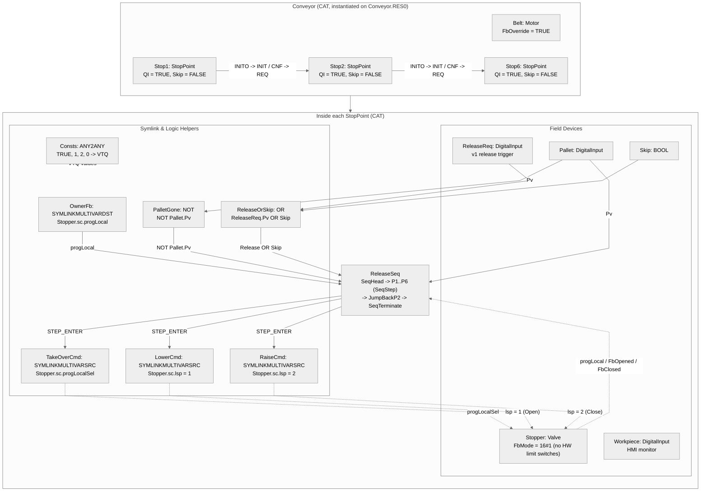
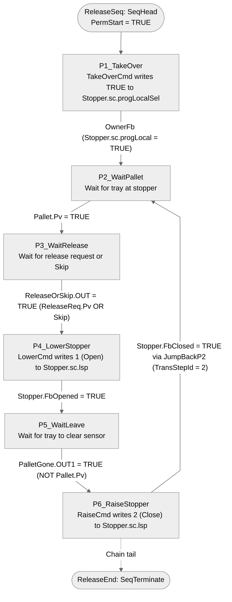

# Festo MPS - Conveyor System in EAE: Project Report

## Summary

This report documents the modular rebuild of the Festo MPS main conveyor loop in EcoStruxure Automation Expert (EAE) 25 inside the `nmps` solution (`nmps/nmps.sln`). Rather than porting the monolithic legacy blocks (`Waypoint`, `ConveyorStationCtrl`, and `TransportGeneral1`) directly from nxtStudio, the conveyor is structured from two Composite Automation Types (CATs) — `StopPoint` and `Conveyor` — assembled from Schneider Electric's standard library blocks (`SE.App2CommonProcess` 25.0.1.5, `SE.AppSequence` 25.0.1.5, and `Runtime.Base` 25.0.1.2).

So far, the `StopPoint` and `Conveyor` CATs are implemented with a shared `Belt` (`Motor`) and three active station interfaces (`Stop1`, `Stop2`, `Stop6`), instantiated on `RES0` of the `Conveyor` `M251_dPAC` device with an `'SEQ_INIT'` (`EVENTCHAINHEAD`) startup chain, and exposed on the `Conveyor` HMI canvas (`1032x640`) for simulation and faceplate testing. Binding to the physical `PLC_CV` TM3 channels (`CV_AB` / `CV_CD`) and aligning the cross-station handshake with the newer station implementation remain to be completed.

## Design

> [!WARNING]
> **Possible deprecation notice:** This initial `Conveyor` / `StopPoint` design follows the earlier `Distribution` pattern (`SE.AppSequence` chains + `SYMLINKMULTIVARSRC` symbolic-link commands) and may be deprecated in favour of the professor's newer `version1` architecture in `festo-mps-400-eae` (`Flexbridge.FestoMPS400` for `Distributing` and `Testing`):
> - **Basic FB with ECC instead of `SE.AppSequence` CATs:** `festo-mps-400-eae` replaces multi-block `SeqHead` / `SeqStep` / `seqTransJumpBackCmd` / `SeqTerminate` sequence CATs with a single Basic FB whose ECC represents one state per step (`DistributingSequence`, `TestingSequence`).
> - **`IDevice` (`ISc`) adapters instead of symbolic links:** Actuators and outputs are commanded directly over wired `IDevice` plugs into each device's `ISc` socket (`REQ_CMD` with `Lsp`, `CNF_STATUS`, `CNF_READY`, and `EnProgReq = TRUE`), eliminating `SYMLINKMULTIVARSRC`, `SYMLINKMULTIVARDST`, and `ANY2ANY` blocks.
> - **`IWaypoint` adapter instead of `ReleaseReq : DigitalInput`:** Station-to-conveyor handshakes in `festo-mps-400-eae` use the `IWaypoint` adapter (`STATE_REQ` and `RELEASE` Plug → Socket; `TRAY` with `Tray` and `Workpiece` Socket → Plug) instead of a standalone `DigitalInput` trigger.
> - **Full loop hardware (`PLC_CV`):** On the physical plant (`plant.yaml`), `plc-conveyor` (`PLC_CV`, two `TM3DI16G`/`TM3DQ16RG` pairs `CV_AB` and `CV_CD`) drives 4 belt sections (`conveyor-a`–`conveyor-d`) and all 6 interface stoppers (`if1`–`if6`, including unused interfaces `if3`–`if5`), whereas this first CAT models a single `Belt` (`Motor`) and the three active station interfaces (`Stop1`, `Stop2`, `Stop6`).

*Figure 1. Block structure of `Conveyor` and `StopPoint`. `Belt` runs independently under its `Motor` faceplate, while `Stop1`, `Stop2`, and `Stop6` encapsulate each interface stopper's devices, logic, and looping sequence.*

*Figure 2. Looping six-step `ReleaseSeq` sequence inside `StopPoint`. After taking `Program Local` ownership once in `P1_TakeOver`, the sequence loops `P2_WaitPallet` → `P6_RaiseStopper` via `JumpBackP2` (`TransStepId = 2`).*

## Implementation

### Devices and blocks

| Component | CAT / Location | Library / Type | Configuration & Purpose |
| --- | --- | --- | --- |
| `Belt` | `Conveyor` | `SE.App2CommonProcess.Motor` | Drives the conveyor belt; `FbOverride = TRUE` in `Conveyor_CAT.offline.xml` because the hardware has no motor run-feedback contact. |
| `Stop1`, `Stop2`, `Stop6` | `Conveyor` | `Main.StopPoint` | One stop-point CAT per active interface (`if1`, `if2`, `if6`), with `QI = TRUE` and `Skip = FALSE`, chained on `INIT`/`INITO` and `REQ`/`CNF`. |
| `Stopper` | `StopPoint` | `SE.App2CommonProcess.Valve` | Single-coil stopper valve (`Open` = lower/release, `Close` = raise/block); `FbMode = 16#1` in `StopPoint_CAT.offline.xml` (no physical end-position switches). |
| `Pallet` | `StopPoint` | `SE.App2CommonProcess.DigitalInput` | Tray-present sensor at the stopper. |
| `Workpiece` | `StopPoint` | `SE.App2CommonProcess.DigitalInput` | Workpiece-on-tray sensor; exposed on the HMI canvas for monitoring. |
| `ReleaseReq` | `StopPoint` | `SE.App2CommonProcess.DigitalInput` | Release-request input used as the v1 HMI/override trigger; ORed with `Skip` in `ReleaseOrSkip`. |
| `ReleaseSeq` | `StopPoint` | `SE.AppSequence.SeqHead` + 6 × `SeqStep` + `seqTransJumpBackCmd` + `SeqTerminate` | Loops tray arrival, release wait, stopper lowering, departure wait, and stopper raising. |

### `ReleaseSeq` sequence steps

| Step | Command | Done when |
| --- | --- | --- |
| `P1_TakeOver` | `TakeOverCmd` writes `TRUE` (`Consts.OUT1`) to `${PATH}Stopper.sc.progLocalSel`. | `OwnerFb` (`${PATH}Stopper.sc.progLocal`) reports `TRUE`. |
| `P2_WaitPallet` | None; waits for a tray to arrive at the stopper. | `Pallet.Pv` is `TRUE`. |
| `P3_WaitRelease` | Evaluates `ReleaseOrSkip` (`ReleaseReq.Pv OR Skip`). | `ReleaseOrSkip.OUT` is `TRUE`. |
| `P4_LowerStopper` | `LowerCmd` writes `1` (`Open`, `Consts.OUT2`) to `${PATH}Stopper.sc.lsp`. | `Stopper.FbOpened` is `TRUE` (immediate with `FbMode = 16#1`). |
| `P5_WaitLeave` | Evaluates `PalletGone` (`NOT Pallet.Pv`). | `PalletGone.OUT1` is `TRUE` (tray has cleared the sensor). |
| `P6_RaiseStopper` | `RaiseCmd` writes `2` (`Close`, `Consts.OUT3`) to `${PATH}Stopper.sc.lsp`. | `Stopper.FbClosed` is `TRUE`; `JumpBackP2` loops back to `P2_WaitPallet` (`TransStepId = 2`). |

## Testing

All verification runs on EAE's simulated controller (`Conveyor` `M251_dPAC` in `Local Test` mode), using the `Conveyor` HMI canvas (`Belt`, plus `Stopper`, `ReleaseSeq`, `Pallet`, `Workpiece`, and `ReleaseReq` grouped under `Stop 1`, `Stop 2`, and `Stop 6`).

### Setup

1. Open `nmps/nmps.sln` in EAE 25 with `SE.App2CommonProcess`, `SE.App2Base`, `SE.AppSequence` (`25.0.1.5`), and `Runtime.Base` (`25.0.1.2`).
2. In **Deploy and Diagnostic**, set **Active Network Profile** to `Local Test` and start Runtime Simulation for the `Conveyor` device. Log in, run **Deploy and Restart**, log in again, and **Deploy** (`Conveyor` status reads `Running`).
3. Under **HMI → Canvases**, confirm `Conveyor` is set as **Startup Canvas** (rebuild the HMI project if changed so `HMIRuntimeDatabase.cfg` updates `FirstCanvas="Conveyor"`), then click **Start Local HMI** and log in.
4. Clear any initial start-up alarm (`!`) via **Rearm** on the affected faceplate. Because `Belt.FbOverride = TRUE` and `Stopper.FbMode = 16#1` are configured in the CAT offline defaults, simulated actuator feedback responds automatically; sensor signals are driven using **Override** on each `DigitalInput` faceplate.

### Test scenarios and results

| # | Do this | Expect | Result |
| --- | --- | --- | --- |
| 1 | **Belt motor manual control.** Open the `Belt` (`Motor`) faceplate, switch Owner to `Operator`, press `Run` (`Start`), then press `Stop`. | `Status` transitions to `Running` and back to `Stopped`, and the belt symbol follows. | Passed |
| 2 | **Stopper valve manual check (`Stop1`, `Stop2`, `Stop6`).** On each `Stopper` (`Valve`) faceplate, switch Owner to `Operator`, press `Open` (lower stopper) and `Close` (raise stopper), then leave it `Closed` and switch Owner back to `Program`. | With `FbMode = 16#1`, `Status` transitions `Opening -> Opened` and `Closing -> Closed`, and `Stopper` ends `Closed` under `Program`. | Passed |
| 3 | **Sequence take-over and idle wait (`P1` → `P2`).** With `Pallet` and `ReleaseReq` `Off` (`FALSE`) and `Stopper` in `Program`, open `Stop1.ReleaseSeq`, switch Owner to `Operator`, set Mode to `Auto`, and press `Start`. | `Stopper` owner switches to `Program Local`, `P1_TakeOver` completes at once, and `ReleaseSeq` waits in Step 2 (`P2_WaitPallet`) with `Stopper` `Closed`. | Passed |
| 4 | **Pallet arrival (`P2` → `P3`) and workpiece indicator.** On `Stop1.Pallet`, enable `Override` and set `Override Value` to `True`. Also toggle `Stop1.Workpiece` Override `True`/`False`. | `ReleaseSeq` advances from Step 2 (`P2_WaitPallet`) to Step 3 (`P3_WaitRelease`) while `Stopper` stays `Closed`; `Workpiece` updates on the canvas without releasing the stopper. | Passed |
| 5 | **Station release request (`P3` → `P4` → `P5`).** While `ReleaseSeq` waits in Step 3 with `Pallet` `True`, enable `Override` on `Stop1.ReleaseReq` and set `Override Value` to `True`. | `ReleaseSeq` runs `P4_LowerStopper`, commands `Stopper` `Open` (lowered), confirms `FbOpened`, and holds in Step 5 (`P5_WaitLeave`) while `Pallet` stays `True`. | Passed |
| 6 | **Pallet departure and loop-back (`P5` → `P6` → `P2`).** Set `Stop1.Pallet` `Override Value` to `False`, then reset `Stop1.ReleaseReq` `Override Value` to `False`. | `ReleaseSeq` runs `P6_RaiseStopper`, commands `Stopper` back to `Closed` (raised), confirms `FbClosed`, and jumps back via `JumpBackP2` to Step 2 (`P2_WaitPallet`). | Passed |
| 7 | **Wait for `Program` owner (`P1` hold) & multi-stop independence.** Set `Stop2.Stopper` Owner to `Operator` and press `Start` on `Stop2.ReleaseSeq`; then return `Stop2.Stopper` to `Program`. Exercise `Stop1`, `Stop2`, and `Stop6` concurrently. | `Stop2.ReleaseSeq` remains in Step 1 (`P1_TakeOver`) until `Stop2.Stopper` returns to `Program`, then enters Step 2; all three stops run independently. | Passed |

