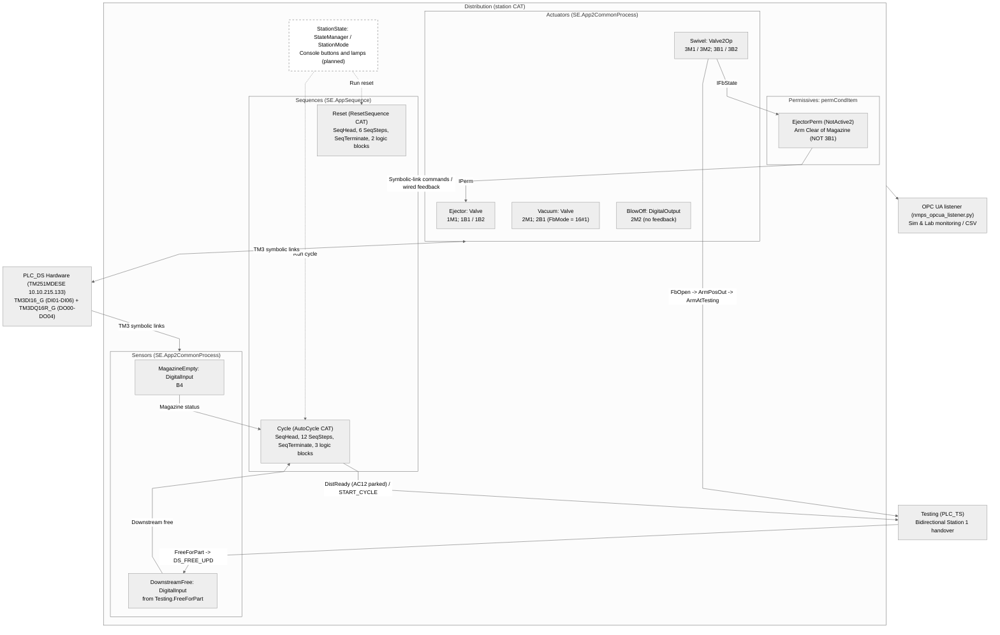
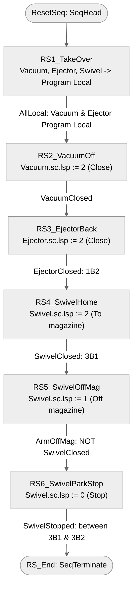
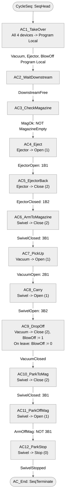
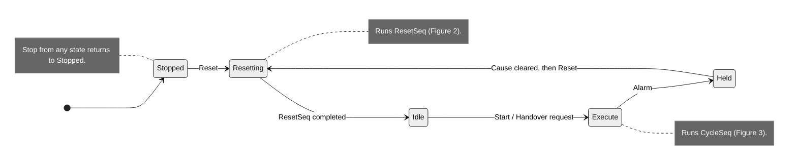

# Festo MPS 400 — Distributing Station (`Distribution`)

| Property | Value |
| --- | --- |
| **Station** | Distributing (Station 1, Interface 1 — feeds Testing) |
| **Station CAT** | `Distribution` (contains `ResetSequence` and `AutoCycle` CATs) |
| **Solution / Device** | `nmps/nmps.sln` → `Distribution` (`M251_dPAC` / `TM251MDESE`, resource `RES0`) |
| **Controller & IP** | `PLC_DS` (`10.10.215.133`, `TM3DI16_G` + `TM3DQ16R_G`) — see [HARDWARE.md](HARDWARE.md) |
| **Reference GRAFCET** | [01_Distributing_GRAFCET.pdf](grafcets/01_Distributing_GRAFCET.pdf) |
| **Libraries** | `SE.App2CommonProcess`, `SE.App2Base`, `SE.AppSequence` (`25.0.1.5`); `Runtime.Base` (`25.0.1.2`); `SE.IoTMx` (`25.0.1.4`); `SE.DPAC` (`25.0.1.10`) |
| **Status** | Implemented, bound to physical I/O, and verified on both EAE Local Simulation and real `PLC_DS` (`10.10.215.133`) |

---

## 1. Overview & Status

This document describes the modular rebuild of the Festo MPS 400 Distributing station control software in EcoStruxure Automation Expert (EAE) 25. Instead of porting hand-written IEC 61499 function blocks from the legacy nxtStudio program, the `Distribution` Composite Automation Type (CAT) assembles Schneider Electric's standard library blocks (`SE.App2CommonProcess` and `SE.AppSequence`), which provide built-in HMI faceplates, alarm handling, owner management, feedback monitoring, and OPC UA variables out of the box.

The station's six device blocks, the `EjectorPerm` permissive, 6-step `ResetSequence`, and 12-step `AutoCycle` are implemented, bound to the physical `PLC_DS` TM3 I/O channels, and verified on both EAE's simulated controller and the physical Festo Distributing rig in EISLAB (including 3-step mid-air swivel parking and the updated HMI canvas with Alarm Grid). Bidirectional Station 1 handover with [Testing](TESTING.md) (`Testing.FreeForPart` → `Distribution.DownstreamFree`, `Distribution.ArmAtTesting` + `DistReady` → `Testing.ArmClear`, and sequential `START_CYCLE` / `DIST_READY_CNF` coordination so `Testing` waits until `Distribution` finishes parking before raising its lift) is implemented (`SwivelPerm` was removed so mid-parking is never blocked when `Testing` receives a workpiece); full 3-PLC commissioning with `PLC_TS` + `PLC_CV` and physical console integration remain to be completed.

### Background & Project History

- **Legacy system & early student port:** The Festo MPS line begins with Distributing, which ejects a workpiece from a stack magazine (`1M1`; `1B1`/`1B2`), picks it up with a suction cup (`2M1`; `2B1`) on a rotary swivel arm (`3M1`/`3M2`; `3B1`/`3B2`), and transfers it to Testing when `IP_FI` reports downstream free. An earlier EAE student port (`Distribution2CAT`) implemented custom blocks (`GiveWorkpiece`, `ArmReset`, `ControlPanel`) adapted from the supervisor's nxtStudio project running on an `nxtControl DCSmini`.
- **Dropped plant-simulator experiment (`DistributionSim`):** To supply synthetic data for other project subgroups before lab hardware deployment was ready, an internal basic FB (`DistributionSim`, 50 ms tick) was added inside `Distribution2CAT`. Because it sat between inputs and consumers, 37 of 83 connections routed through the simulator, making debugging brittle.
- **Pivot to Lifting Luggage & standard libraries:** Data collection for the LLM-KG subgroup moved to a smaller existing EAE example (*Lifting Luggage*, via OPC UA logging to CSV/JSONL/SQLite). Following guidelines discussed with Sandeep, the station rebuild switched to assembling unmodified Schneider Electric library blocks—checked against the AHU workshop reference application, but using `SYMLINKMULTIVARSRC`/`SYMLINKMULTIVARDST` symbolic links from `SE.AppSequence` chains instead of custom adapter-driving basic FBs.

---

## 2. Architecture & Design

The station program follows three engineering rules:

1. **Use library blocks unmodified:** Instantiate `SE.App2CommonProcess`, `SE.App2Base`, and `SE.AppSequence` blocks unchanged and adapt behaviour through offline parameters (`Distribution_CAT.offline.xml`).
2. **Compose by wiring:** Express station safety and workflow by wiring device signals, permissives, and sequence steps.
3. **Minimal custom glue logic:** Only add standard basic logic gates (`AND`, `NOT`, `ANY2ANY`) where a step condition or value conversion requires it.

*Figure 1. Architecture of the `Distribution` CAT. Solid blocks are implemented, bound to `PLC_DS` I/O, and wired for bidirectional `Testing` handover + OPC UA monitoring; the dashed block represents the planned console/supervisory state layer.*

- **Resource startup chain (`RES0`):** `START.COLD` and `START.WARM` initialize `DPAC_FULLINIT`, whose `INITO` initializes and triggers `SeqInit` (`EVENTCHAINHEAD` named `'SEQ_INIT'`); `SeqInit.FINISHED` initializes the `Distribution` instance (`Distribution.INIT`). `START.ONLINECHANGE` re-triggers the same chain via `OC_RETRIGGER` / `OC_DONE`.
- **HMI canvas (`Distribution`):** [`Distribution.cnv.Designer.cs`](../nmps/HMI/Distribution.cnv.Designer.cs) hosts faceplates/symbols for all six devices (`Ejector`, `Swivel`, `Vacuum`, `BlowOff`, `MagazineEmpty`, `DownstreamFree`), both sequence heads (`ResetSeq` and `CycleSeq` via `SE.AppSequence.Symbols.SeqHead.sHead`), and an `AlarmGrid` control for live alarm diagnostics.

---

## 3. Hardware & I/O Mapping

For controller specifications, Ethernet addressing, TM3 wiring conventions, and EISLAB rewiring notes, see [HARDWARE.md](HARDWARE.md).

### Devices & Library Configuration

| Device instance | Library type | Physical signals | Key configuration & notes |
| --- | --- | --- | --- |
| `Ejector` | `SE.App2CommonProcess.Valve` | Coil `1M1`; sensors `1B1`, `1B2` | Inverted rest convention relative to coil: at rest (`1M1` off) the cylinder is extended (`1B2` → `fbClose`); energized (`1M1` on) retracts cylinder to push workpiece out (`1B1` → `fbOpen`). |
| `Swivel` | `SE.App2CommonProcess.Valve2Op` | Coils `3M1`, `3M2`; switches `3B1`, `3B2` | Bidirectional rotary drive (`Open = 1` → `3M2` toward Testing / `3B2`; `Close = 2` → `3M1` toward magazine / `3B1`; `Stop = 0` → neither coil energized, `FbStopped = TRUE` between switches). |
| `Vacuum` | `SE.App2CommonProcess.Valve` | Coil `2M1`; switch `2B1` | Only has an open (part gripped) sensor (`2B1`). Configured with `FbMode = 16#1` (*Only Open fb*, `VarDeclaration ID="7801A8D91AA682F9"`) in `Distribution_CAT.offline.xml` so `Closed` is confirmed by `NOT 2B1`. |
| `BlowOff` | `SE.App2CommonProcess.DigitalOutput` | Coil `2M2` | Plain digital output with no sensor feedback; pulsed during `AC9_DropOff`. |
| `MagazineEmpty` | `SE.App2CommonProcess.DigitalInput` | Light barrier `B4` | `TRUE` when magazine stack is empty (`MagOk` inverts it for `AutoCycle`). |
| `DownstreamFree` | `SE.App2CommonProcess.DigitalInput` | Cross-PLC (`Testing.FreeForPart`) | Driven via IEC 61499 cross-device communication from `Testing.FreeForPart` (`DsConv` + `DsLink` writing `'RES0.Distribution.DownstreamFree.pv.DIn'`) instead of physical `DI07` (`IP_FI`). |

### Physical TM3 I/O Binding (`PLC_DS`)

Bound in [`0d5eb44a-26f1-468d-8caa-7f6bfe966b18.hcf`](../nmps/IEC61499/System/0c9a2a54-81d8-4cd3-8b56-539d6ba31ede/0d5eb44a-26f1-468d-8caa-7f6bfe966b18/0d5eb44a-26f1-468d-8caa-7f6bfe966b18.hcf) (`TM3DI16_G` + `TM3DQ16R_G`):

| TM3 Channel | Festo Tag | Signal Description | EAE Symbolic Link Target (`RES0.Distribution...`) |
| --- | --- | --- | --- |
| `DI00` | — | Spare / not connected | *(unbound)* |
| `DI01` | `1B2` | Ejecting cylinder extended (slide retracted / rest) | `Ejector.fbClose` (`0FBBAF14BDC70C34.21.DIn`) |
| `DI02` | `1B1` | Ejecting cylinder retracted (pushing workpiece out) | `Ejector.fbOpen` (`0FBBAF14BDC70C34.13.DIn`) |
| `DI03` | `2B1` | Vacuum switch (workpiece gripped) | `Vacuum.fbOpen` (`290E8CBB7083A708.13.DIn`) |
| `DI04` | `3B1` | Swivel arm at magazine end position | `Swivel.fbClose` (`DA014101550A683C.15.DIn`) |
| `DI05` | `3B2` | Swivel arm at downstream end position | `Swivel.fbOpen` (`DA014101550A683C.9.DIn`) |
| `DI06` | `B4` | Stack magazine empty light barrier | `MagazineEmpty.pv` (`E97FD2E6D42C4155.6.DIn`) |
| `DI07` | `IP_FI` | Downstream station free (optical coupler receiver) | *(unbound — replaced by `Testing.FreeForPart` cross-PLC link)* |
| `DO00` | `1M1` | Ejecting cylinder push out | `Ejector.cmd` (`0FBBAF14BDC70C34.15.DOut`) |
| `DO01` | `2M1` | Vacuum suction on | `Vacuum.cmd` (`290E8CBB7083A708.15.DOut`) |
| `DO02` | `2M2` | Blow-off / ejection pulse on | `BlowOff.value` (`B5A8A7975D57E904.5.DOut`) |
| `DO03` | `3M1` | Swivel arm move to magazine | `Swivel.cmdClose` (`DA014101550A683C.16.DOut`) |
| `DO04` | `3M2` | Swivel arm move to downstream | `Swivel.cmdOpen` (`DA014101550A683C.11.DOut`) |

*Note:* `DI08`–`DI11` and `DO08`–`DO11` are physically wired from the Festo operator console (`XMG1`) according to the lab standard (`S1`–`S4`, `P1`–`P4`), and remain unbound in software until console logic is added.

### Permissives (`permCondItem`)

| Instance | Target `IPerm` | Feedback Source | Parameters | Purpose |
| --- | --- | --- | --- | --- |
| `EjectorPerm` | `Ejector.IPerm` | `Swivel.IFbState` | `$CondCause = NotActive2`, `$CondPos = Active1`, `$CondName = 'Arm Clear of Magazine'` | Permits `Ejector` to open (`1M1`) only while `3B1` (`Active2` / closed at magazine) is `FALSE`, preventing workpiece ejection collisions while still allowing ejection from **mid-park**. |

A permissive prevents a disallowed command from starting (displaying a `⊘` badge on the device symbol and listing the condition on its faceplate), rather than interrupting an already active move. *(Note: an earlier `SwivelPerm` blocking `Swivel Open` on `DownstreamFree` was removed because `DownstreamFree` drops to `FALSE` at `AC9_DropOff`, which blocked `AC11_ParkOffMag` and `RS5_SwivelOffMag` from moving the arm off `3B1`; downstream availability is enforced by `AC2_WaitDownstream` instead.)*

---

## 4. Control Sequences

Both sequences are implemented using `SE.AppSequence` (`SeqHead`, `SeqStep`, `SeqTerminate`) inside dedicated CATs ([`ResetSequence.fbt`](../nmps/IEC61499/ResetSequence/ResetSequence.fbt) and [`AutoCycle.fbt`](../nmps/IEC61499/AutoCycle/AutoCycle.fbt)), using [`01_Distributing_GRAFCET.pdf`](grafcets/01_Distributing_GRAFCET.pdf) as the functional reference.

- **Two sequences by design:** `ResetSequence` safely recovers from any aborted cycle or manual test (drops any held workpiece via `RS2_VacuumOff`, retracts `Ejector`, and mid-parks `Swivel`) **without** pushing a new workpiece out of the magazine. `AutoCycle` performs a production handover starting from the clean mid-parked state.
- **Event & command mechanics:** Because `SE.AppSequence` action blocks emit plain types while `SE.App2CommonProcess` expects VTQ values, each step triggers a `SYMLINKMULTIVARSRC` block on `STEP_ENTER` (writing `TRUE` to `sc.progLocalSel` or `0`/`1`/`2` to `sc.lsp`) using constants converted by `ANY2ANY`. Every step's `TRANS_REQ` fires both on command `CNF` (immediate pass if already satisfied) and on every wired device/sensor feedback event, so transitions rely strictly on confirmed physical state—never blind timers.

### 4.1 Reset Sequence (`ResetSequence`)

| Step ID | Action (`SYMLINKMULTIVARSRC`) | Transition Condition (`Exceeded`) | Notes |
| --- | --- | --- | --- |
| `RS1_TakeOver` | `Vacuum`, `Ejector`, `Swivel` → `sc.progLocalSel := TRUE` | `AllLocal` (`Vacuum.sc.progLocal AND Ejector.sc.progLocal AND TRUE`) | Switches actuators to `Program Local`; `Swivel` feedback bit is bypassed (`TRUE`) due to the `Valve2Op` library bug. |
| `RS2_VacuumOff` | `Vacuum.sc.lsp := 2` (`Close`) | `VacuumClosed` (`NOT 2B1`) | Releases any workpiece stuck on the suction cup. |
| `RS3_EjectorBack` | `Ejector.sc.lsp := 2` (`Close`) | `EjectorClosed` (`1B2`) | Ensures ejector slide is retracted (cylinder extended) at rest. |
| `RS4_SwivelHome` | `Swivel.sc.lsp := 2` (`Close`) | `SwivelClosed` (`3B1`) | Swings arm to a known reference (`3B1` at magazine). |
| `RS5_SwivelOffMag` | `Swivel.sc.lsp := 1` (`Open`) | `ArmOffMag` (`NOT SwivelClosed`) | Moves arm off `3B1` toward downstream until `3B1` clears. |
| `RS6_SwivelParkStop` | `Swivel.sc.lsp := 0` (`Stop`) | `SwivelStopped` (`NOT 3B1 AND NOT 3B2`) | Cuts both coils so arm rests between switches—clear of both magazine/ejector and Testing's lift, and clearing `Valve2Op`'s startup feedback alarm. |

*Figure 2. `ResetSequence` (6 steps, including 3-step mid-parking `RS4`–`RS6`).*

### 4.2 Automatic Cycle (`AutoCycle`)

Because the arm rests in mid-park and `EjectorPerm` (`NotActive2`) permits ejection whenever the arm is clear of `3B1`, `AutoCycle` omits the legacy empty swing to downstream at the start of every cycle and ejects immediately once `DownstreamFree` and magazine stock are confirmed.

| Step ID | Action (`SYMLINKMULTIVARSRC`) | Transition Condition (`Exceeded`) | Notes |
| --- | --- | --- | --- |
| `AC1_TakeOver` | `Vacuum`, `Ejector`, `Swivel`, `BlowOff` → `sc.progLocalSel := TRUE` | `AllLocal` (`Vacuum AND Ejector AND BlowOff`) | Acquires `Program Local` ownership (omits `Swivel` feedback due to `Valve2Op` bug). |
| `AC2_WaitDownstream` | None (wait step) | `DownstreamFree` (from `Testing.FreeForPart`) | Holds until Testing / downstream is free. |
| `AC3_CheckMagazine` | None (wait step) | `MagOk` (`NOT MagazineEmpty`, `NOT B4`) | Holds until a workpiece is present in the stack magazine. |
| `AC4_Eject` | `Ejector.sc.lsp := 1` (`Open`) | `EjectorOpen` (`1B1`) | Pushes bottom workpiece out to pickup position. |
| `AC5_EjectorBack` | `Ejector.sc.lsp := 2` (`Close`) | `EjectorClosed` (`1B2`) | Retracts magazine slide before arm swings over. |
| `AC6_ArmToMagazine` | `Swivel.sc.lsp := 2` (`Close`) | `SwivelClosed` (`3B1`) | Swings swivel arm over the ejected workpiece at `3B1`. |
| `AC7_PickUp` | `Vacuum.sc.lsp := 1` (`Open`) | `VacuumOpen` (`2B1`) | Turns vacuum on and waits for confirmed grip (`2B1`). |
| `AC8_Carry` | `Swivel.sc.lsp := 1` (`Open`) | `SwivelOpen` (`3B2`) | Carries gripped workpiece to Testing (`3B2`). |
| `AC9_DropOff` | Enter: `Vacuum := 2`, `BlowOff := 1`; Leave: `BlowOff := 0` | `VacuumClosed` (`NOT 2B1`) | Releases vacuum and pulses `BlowOff` until drop confirmed. |
| `AC10_ParkToMag` | `Swivel.sc.lsp := 2` (`Close`) | `SwivelClosed` (`3B1`) | Begins 3-step mid-park by touching known `3B1` switch. |
| `AC11_ParkOffMag` | `Swivel.sc.lsp := 1` (`Open`) | `ArmOffMag` (`NOT SwivelClosed`) | Drives arm off `3B1` switch. |
| `AC12_ParkStop` | `Swivel.sc.lsp := 0` (`Stop`) | `SwivelStopped` (`NOT 3B1 AND NOT 3B2`) | Parks arm mid-air clear of both Distributing and Testing. |

*Figure 3. `AutoCycle` (12 steps with streamlined ejection from mid-park and 3-step mid-parking at cycle end).*

### 4.3 Supervisory State Management (Planned / Optional)

A supervisory state layer (`SE.App2StateManagement.StateManager` or a lightweight 4-state `StationMode` FB) is planned once the physical console buttons/lamps are wired or full line coordination is enabled:

*Figure 4. Planned supervisory station state model.*

---

## 5. Commissioning & Verification

### 5.1 Local Simulation Setup & Tests

1. Open `nmps/nmps.sln` in EAE 25 with the libraries listed in the header table.
2. In **Deploy and Diagnostic**, set **Active Network Profile** to `Local Test` and start Runtime Simulation for `Distribution` (and `Testing` when testing cross-station handover; `Testing` exposes OPC UA on port `4841` while `Distribution` uses `4840`). Log in (`aic3`), run **Deploy** (with **Delete persistent data** checked if offline defaults like `Vacuum.FbMode` changed), and verify status reads `Running`.
3. Start the Local HMI with `Distribution` as the startup canvas (use [`nmps_opcua_listener.py`](../nmps_opcua_listener.py) via `python nmps_opcua_listener.py --csv sim_test.csv` to monitor both stations concurrently). On each device's faceplate, enable **Simulation** and press **Rearm** if needed to clear any startup alarm.

| # | Test Scenario | Expected Outcome | Status |
| --- | --- | --- | --- |
| 1 | **Manual actuator control.** Switch Owner to `Operator` on `Ejector`, `Swivel`, and `Vacuum` faceplates; test `Open` / `Close` (and `Stop` on `Swivel`). | Status follows `Opening → Open → Closing → Closed` (`Stopped` on `Swivel`); HMI symbols match. | Passed |
| 2 | **`EjectorPerm` (`Arm Clear of Magazine`).** Enable `Override = True` on `DownstreamFree`. Close `Swivel` to `3B1`, try `Open` on `Ejector`; then move `Swivel` off `3B1` (mid-park or downstream) and retry. | Blocked (`⊘` badge, `Arm Clear of Magazine` red on faceplate) while at `3B1`; allowed once arm is off `3B1` (mid-parked or downstream). | Passed |
| 3 | **Cross-station handover & unblocked mid-park.** Run both `Distribution` and `Testing`; trigger `Testing.PartAvailable = On` right at `AC9_DropOff` while `Swivel` is still at `3B2`. | `Testing.FreeForPart` flips `Distribution.DownstreamFree` to `False`; `Distribution` still completes `AC10`–`AC12` mid-park without stalling at `AC11`; `Testing` holds at `TC3_WaitPart` until `Swivel` leaves `3B2`. | Passed |
| 4 | **6-step `ResetSeq` (including mid-park).** Leave devices open/manual, return device owners to `Program`, open `ResetSeq` faceplate (`Operator` → `Start`). | `Vacuum` closes, `Ejector` retracts (`1B2`), `Swivel` goes to `3B1` (`RS4`), moves off `3B1` (`RS5`), stops (`RS6`), and `ResetSeq` completes. | Passed |
| 5 | **Take-over wait.** Set `Ejector` Owner to `Operator`, start `ResetSeq`, then `Stop`, restore `Program`, and restart. | Sequence holds in `RS1_TakeOver` until `Stop`; second run reaches `Completed`. | Passed |
| 6 | **12-step `AutoCycle` (Semi-Auto & Auto).** Set `DownstreamFree` Override `True`, `MagazineEmpty` `False`, run `CycleSeq` in `Semi-Auto` and `Auto`. | Steps execute `AC1`–`AC12` in order (`BlowOff` pulses on during `AC9` and off on leave), ending mid-parked in `Completed`. | Passed |
| 7 | **Downstream wait & mid-cycle recovery.** Set `DownstreamFree` `False` to verify hold at `AC2`; stop `CycleSeq` mid-cycle and run `ResetSeq`. | Cycle pauses at `AC2` until `DownstreamFree = True`; `ResetSeq` safely drops any gripped part and re-parks the arm. | Passed |

### 5.2 Physical PLC Deployment & Verification (`PLC_DS`, `10.10.215.133`)

1. Ensure the engineering PC Ethernet adapter is on `10.10.0.20` / `255.255.0.0` (no gateway) and **Active Network Profile** in EAE is `(Default)`.
2. Verify `PLC_DS` (`10.10.215.133`) is assigned to logical device `Distribution` (`0d5eb44a-26f1-468d-8caa-7f6bfe966b18`) and `0d5eb44a-26f1-468d-8caa-7f6bfe966b18.hcf` uses **`TM3DQ16R_G`** with `DI01`–`DI06` (`DI07` unbound) and `DO00`–`DO04` bound.
3. If the M251 dPAC shield icon is empty red (*Security Not Set*), run **Configure Security** first with Schneider factory default credentials (`User: installer`, `Password: Inst@ller1`), click **Trust** on the certificate prompt, then log in as the solution's `aic3` user.
4. Run **Deploy** with **Delete persistent data** checked whenever offline parameter defaults (`Vacuum.FbMode = 16#1`) are modified.
5. On the `Distribution` HMI canvas, ensure **Simulation** is disabled on all actuator faceplates, override `DownstreamFree = True` only when `Distribution` runs standalone without `PLC_TS`, and ensure compressed air and stack workpieces are present.

| Physical Check on `PLC_DS` | Verified Outcome |
| --- | --- |
| **Individual actuators in `Operator` mode** | `1M1` (`Ejector`), `3M1`/`3M2` (`Swivel`), `2M1` (`Vacuum`), and `2M2` (`BlowOff`) actuate physically and match `1B1`/`1B2`, `2B1`, `3B1`/`3B2` indicators. |
| **`EjectorPerm` safety interlock** | `Ejector` is blocked while `Swivel` is at `3B1` and allowed when clear of magazine. |
| **`ResetSeq` mid-parking** | Arm moves to `3B1`, steps off `3B1`, and halts cleanly between `3B1` and `3B2` (`FbStopped = TRUE`) without triggering feedback alarms (after initial startup transient settled). |
| **`CycleSeq` end-to-end workpiece handover** | Station ejects a workpiece, retracts ejector, swings to `3B1`, grips with vacuum (`2B1`), swings to `3B2`, releases with `BlowOff` pulse, and mid-parks. |

---

## 6. Problems & Solutions

1. **`SeqActionOnEnter` cannot write to `SE.App2CommonProcess` device links.**
   `SE.AppSequence` action blocks emit plain types (`INT`/`BOOL`), whereas App2 device blocks require VTQ structs (`VTQINT`/`VTQBOOL`), and symbolic links require identical endpoint types.
   *Solution:* Drive each command from `STEP_ENTER` / `STEP_LEAVE` via `SYMLINKMULTIVARSRC` paired with `ANY2ANY` constants.
2. **`Valve2Op` / `Motor2Op` never confirm `sc.progLocal` (`AllLocal` deadlock).**
   In `SE.App2CommonProcess` 25.0.1.5, the internal symbolic-link reader for `sc.progLocal` inside `Valve2Op` leaves `$QI` unset, so `ProgLocal` changes on the faceplate but never publishes back to sequences (`ResetSeq` hung indefinitely at `RS1_TakeOver`).
   *Solution:* Keep writing `Swivel.sc.progLocalSel := TRUE`, but hardwire the `Swivel` input of `AllLocal` (`AND`) to `TRUE`. `RS4`–`RS6` still enforce `Swivel` physical completion.
3. **Simulated controller blocked on Windows (`winnat` port 51500 conflict).**
   Windows NAT (`winnat`, often alongside WSL) can reserve TCP ports around `51500` needed by EAE Runtime Simulation, failing login with *"Device cannot be authenticated"*.
   *Solution:* Run `net stop winnat` as Administrator before starting Simulation, then `net start winnat` afterwards.
4. **Hardware config relay vs transistor mismatch (`TM3DQ16R_G` vs `TM3DQ16T_G`) & stray quote.**
   Physical PLC racks use `TM3DQ16RG` relay output modules (`TM3DQ16R_G` in `.hcf`), whereas the initial config had `TM3DQ16T_G` plus an accidental `"` (`&quot;`) on `DI00`.
   *Solution:* Replaced `TM3DQ16T_G` with `TM3DQ16R_G` and cleared `DI00` in the `.hcf`.
5. **M251 dPAC initial security rejection (`Rejected by device`).**
   A factory-fresh or reset M251 dPAC (empty red shield in Topology) has no solution RBAC users loaded, so **Configure Security** rejects `aic3`.
   *Solution:* Authenticate the first **Configure Security** call with Schneider's factory default credentials (`installer` / `Inst@ller1`) and trust the device certificate; subsequent logins use `aic3`.
6. **`Vacuum` startup `Detected Feedback Failure`.**
   Vacuum suction cup `2A1` only has an open switch (`2B1`) and no closed sensor; default `FbMode = 16#0` expected a closed feedback signal.
   *Solution:* Set `Vacuum` `FbMode = 16#1` (*Only Open fb*) in [`Distribution_CAT.offline.xml`](../nmps/IEC61499/Distribution/Distribution_CAT.offline.xml) and deploy with **Delete persistent data** checked so the new default takes effect.
7. **`Swivel` startup `Detected Feedback Failure` & arm clearance.**
   `Valve2Op` boots with setpoint `0` (*Stop*), expecting neither `3B1` nor `3B2` active (`FbStopped = NOT (3B1 OR 3B2)`). Resting on either end switch raises a feedback alarm on startup, while resting at `3B1` blocks the ejector and resting at `3B2` collides with Testing's lift.
   *Solution:* Implemented 3-step mid-parking (`ToMag → OffMag → Stop`) in both `ResetSequence` and `AutoCycle` and updated `EjectorPerm` from `Active1` to `NotActive2`.
8. **EAE solution lock file (`.lock_sln`).**
   Editing EAE `.fbt`/`.hcf`/`.xml` files on disk while `nmps.sln` is open (`nmps/.lock_sln` exists) risks crashes or overwritten edits.
   *Solution:* Always close EAE before external XML edits, or edit directly in the EAE IDE when open.
9. **`SwivelPerm` deadlocked `AC11_ParkOffMag` / `RS5_SwivelOffMag`, and lift/arm handover collision risk.**
   Once `Distribution` was wired to `Testing.FreeForPart`, dropping a workpiece at `AC9_DropOff` set `DownstreamFree = FALSE`, so `SwivelPerm` (`$CondPos = Active1`) blocked `AC11_ParkOffMag` (`Swivel := 1 / Open`) from stepping off `3B1` to mid-park (and likewise blocked `RS5_SwivelOffMag` whenever `Testing` was occupied). Meanwhile, `Testing` could raise `Lift` as soon as `3B2` (`ArmAtTesting`) turned `FALSE`, while the swivel arm was still swinging back toward the magazine—causing a physical arm-to-lift collision.
   *Solution:* Removed `SwivelPerm` (downstream availability is already enforced at `AC2_WaitDownstream`), and updated [Testing](TESTING.md) so `ArmClear` requires **`(NOT ArmAtTesting) AND DistReady`** (`ArmSafeAnd`), while `Station1Coord` runs `Distribution` first (`START_CYCLE`) and only starts `Testing` once `DistReady` returns `TRUE` after `AC12_ParkStop`.

---

## 7. Remaining Work

- **Station 1 integration (`Testing` + `Conveyor`):** Bidirectional `Distribution` ↔ `Testing` handover (`FreeForPart` / `ArmAtTesting`) and sequential `Station1Coord` + `Stop1Coord` coordination with [`Conveyor`](CONVEYOR.md) (`START_CYCLE` and `DIST_READY_CNF` / `DistReady` exposed on [`AutoCycle.fbt`](../nmps/IEC61499/AutoCycle/AutoCycle.fbt) and [`Distribution.fbt`](../nmps/IEC61499/Distribution/Distribution.fbt)) are implemented in [`6176bcc6-dc42-44e0-920e-ad204ed015ce.syslay`](../nmps/IEC61499/System/0c9a2a54-81d8-4cd3-8b56-539d6ba31ede/9bf3b433-92e3-4d31-8cff-c20036297fe9/6176bcc6-dc42-44e0-920e-ad204ed015ce.syslay); integrated 3-PLC rebuild/commissioning (`PLC_DS` + `PLC_TS` + `PLC_CV`) remains to be completed.
- **Console I/O & state layer:** Bind physical console channels (`DI08`–`DI11`, `DO08`–`DO11`) and decide between `SE.App2StateManagement.StateManager` or a compact 4-state `StationMode` FB (also releasing actuators back to `Operator` when stopped).
- **OPC UA exposure check:** [`nmps_opcua_listener.py`](../nmps_opcua_listener.py) now monitors all three stations (`Distribution`, `Testing`, and `Conveyor`) by default in `--mode sim` and `--mode lab`; verify published OPC UA nodes on physical hardware while staying within each M251 dPAC's node budget (`MaxVariableNodes = 500`, ~100 KB `ecort_opcua_ns2.bin`).
