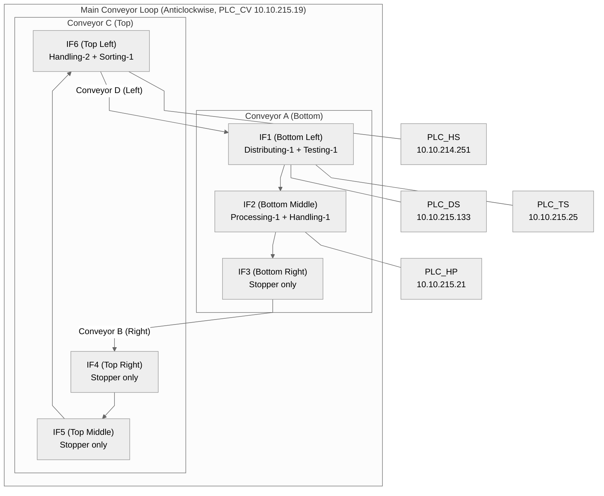
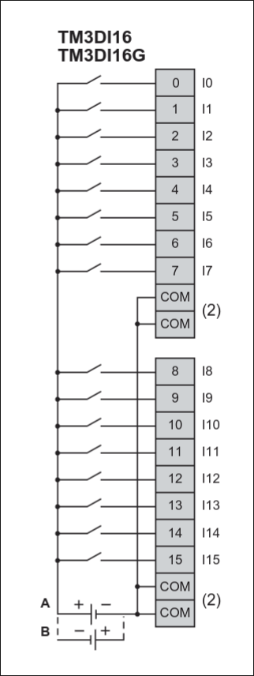
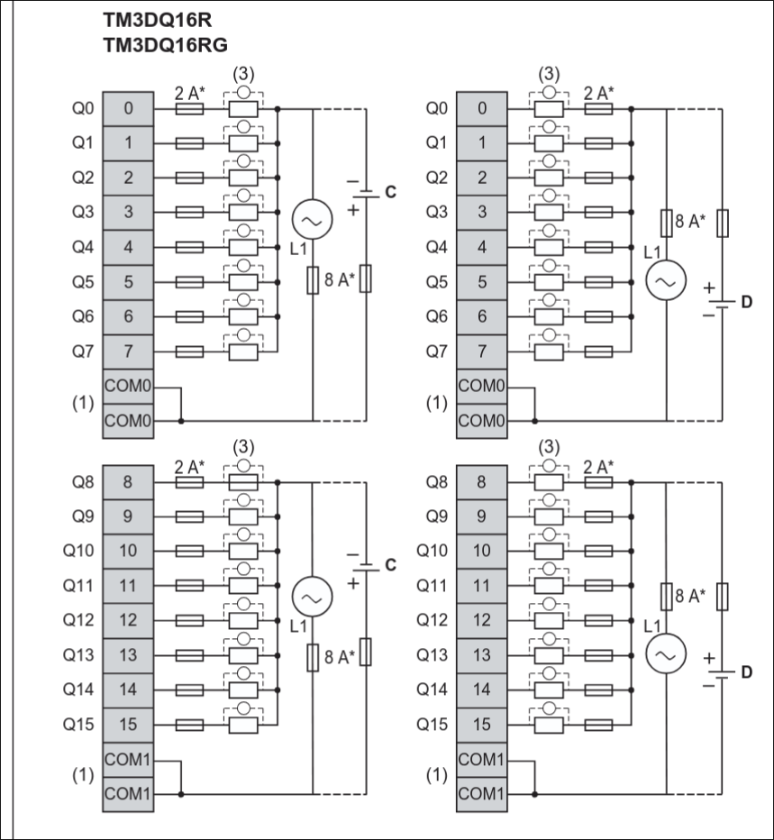
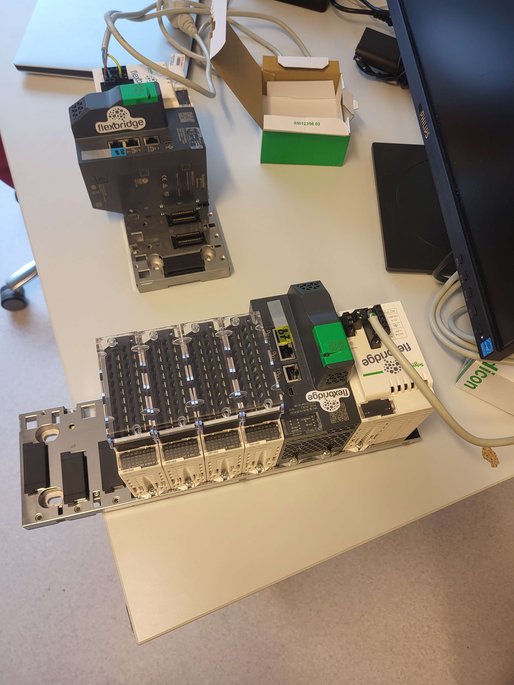
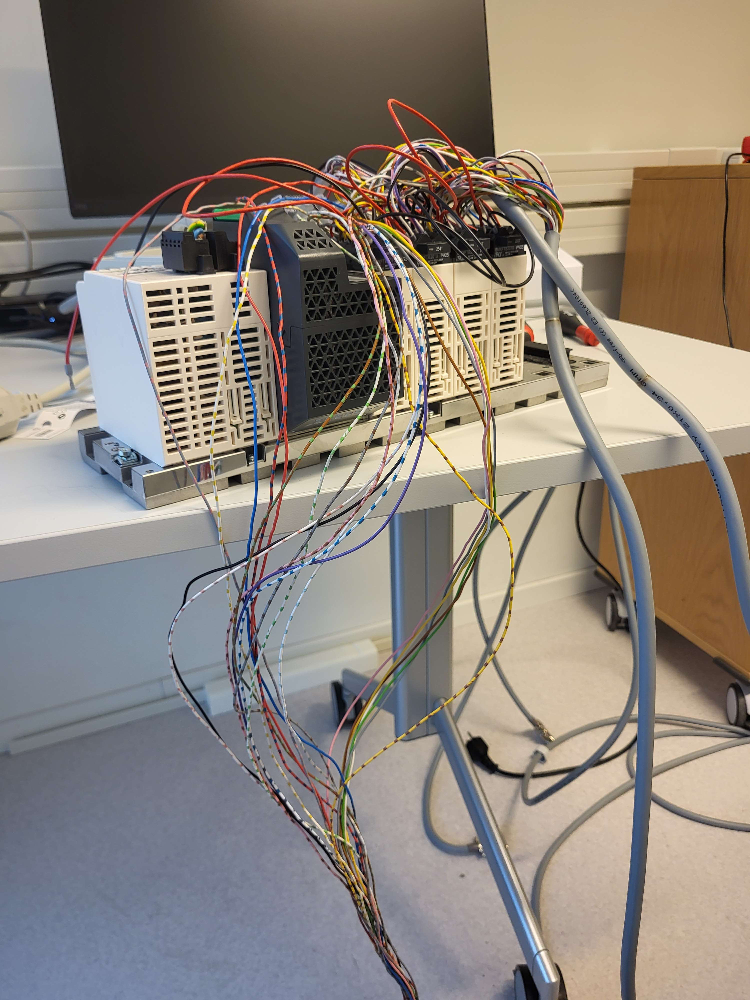
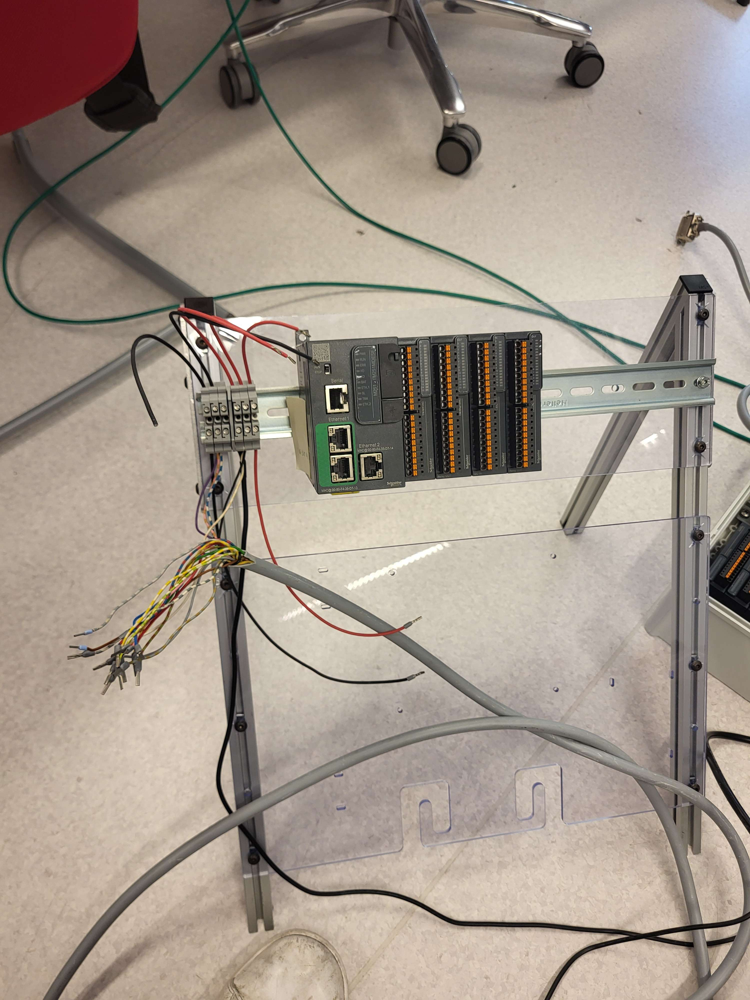
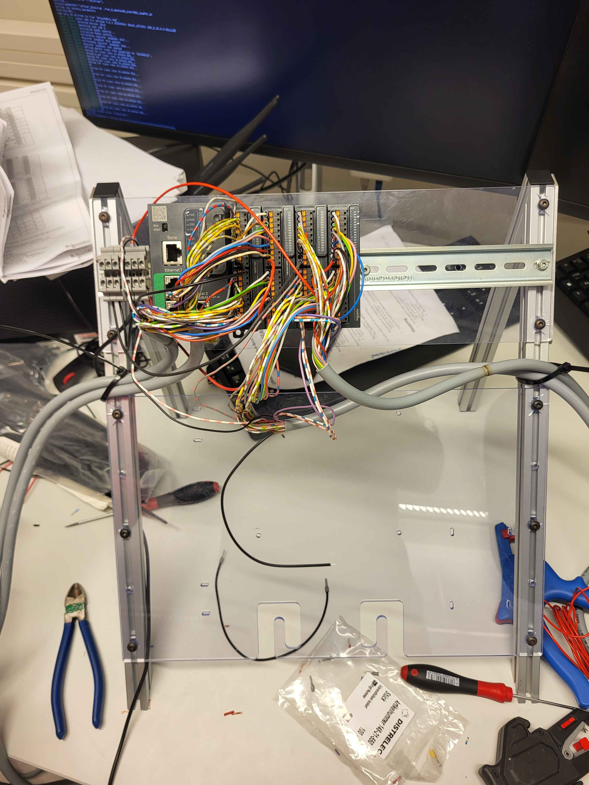
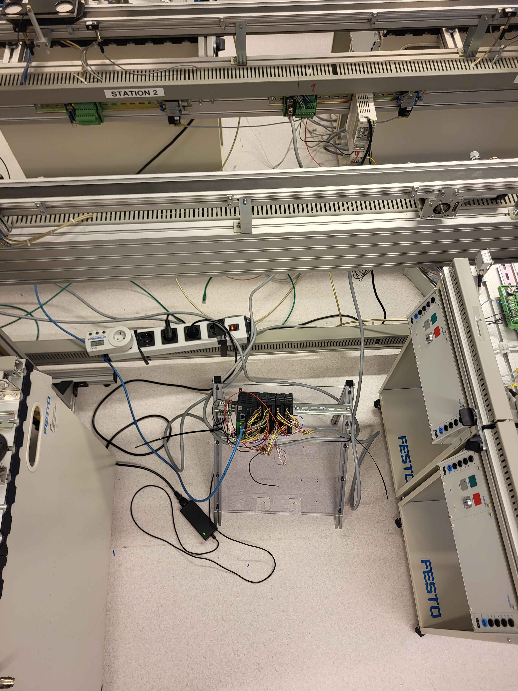

# EISLAB Festo MPS 400 — Hardware, Rewiring & Network Reference

Reference documentation for the Festo MPS 400 physical testbed at EISLAB (Luleå University of Technology), covering the Modicon M251 dPAC controllers, TM3 I/O wiring, network configuration, and the hardware rewiring log.

---

## 1. Overview & Motivation

The Festo MPS 400 installation in EISLAB is over 10 years old and originally ran on legacy nxtStudio controllers (nine controllers in total: nxtControl `DCSmini` PLCs per station plus a Beckhoff CX2030 for the conveyor loop). Because that legacy hardware lacks firmware support for Schneider Electric **EcoStruxure Automation Expert (EAE) 25.0.1**, the active stations (Stations 1, 2, 6, and the main conveyor loop) were rewired to **five Modicon M251 dPAC (`TM251MDESE`)** controllers with **TM3** digital I/O expansion racks.

---

## 2. Plant Layout & Controller Inventory

The main transport system consists of **four conveyors (`A`, `B`, `C`, `D`)** arranged in an **anticlockwise** closed loop with six tray stopper interfaces (`IF1`–`IF6`). Only interfaces `1`, `2`, and `6` host stations today (the legacy robot cell at `IF4` is removed); `IF3`, `IF4`, and `IF5` retain stoppers for tray traffic control.

*Figure 1. EISLAB Festo MPS 400 loop layout and controller allocation.*

### M251 dPAC Controller Table

All five controllers run **M251 dPAC (`TM251MDESE`)** with **dPAC (EcoRT) `25.0.1`** firmware (matching EAE `25.0 UP 1`):

| PLC ID | Role / Station(s) | Interface | TM3 Module Pairs | MAC Last Bytes | `ETH1` IP (EAE & HMI) | `ETH2` IP (Config) |
| --- | --- | --- | --- | --- | --- | --- |
| `PLC_DS` | Distributing (`distributing-1`) | IF1 | 1 pair | `D7:85` | `10.10.215.133` | `10.11.215.133` |
| `PLC_TS` | Testing (`testing-1`) | IF1 | 1 pair | `D7:19` | `10.10.215.25` | `10.11.215.25` |
| `PLC_HP` | Handling-1, Processing-1 (in pair order) | IF2 | 2 pairs | `D7:15` | `10.10.215.21` | `10.11.215.21` |
| `PLC_CV` | Main conveyor loop (`Conveyor A–D`, `IF1–IF6`) | Loop | 2 pairs (`CV_AB`, `CV_CD`) | `D7:13` | `10.10.215.19` | `10.11.215.19` |
| `PLC_HS` | Handling-2, Sorting-1 (in pair order) | IF6 | 2 pairs | `D6:FB` | `10.10.214.251` | `10.11.214.251` |

*Auxiliary HTTP remote I/O:* Three station busy status lamps (Testing, Handling @ IF2, Handling @ IF6) remain on the HTTP remote I/O module at `10.135.109.113`.

---

## 3. TM3 I/O Modules & Wiring Convention

### Module Layout & Pitfalls

Each I/O rack uses alternating 16-channel input and output modules on the `BMTM3` bus:

- **Digital Input:** `TM3DI16G` (16 × 24 V DC inputs; `TM3DI16_G` in EAE Hardware Configuration).
- **Digital Output:** `TM3DQ16RG` (16 × **relay** outputs; `TM3DQ16R_G` in EAE Hardware Configuration).

> **Important EAE pitfall:** Always select **`TM3DQ16R_G`** (relay) rather than `TM3DQ16T_G` (transistor) in the `.hcf` hardware configuration—the physical EISLAB modules are relay modules, and a type mismatch prevents hardware bus startup/deployment.

### Channel Allocation Convention

Every station pair follows a uniform 16-channel split:

| Channel Range | Station I/O Module (`TM3DI16_G` / `TM3DQ16R_G`) | Conveyor PLC (`PLC_CV`) |
| --- | --- | --- |
| **Channels `0–7`** | Station I/O terminal (`XMA2` via SysLink) — actuators & sensors | Pair 1 (`0–15`): Conveyors A & B; Pair 2 (`0–15`): Conveyors C & D |
| **Channels `8–15`** | Control console (`XMG1` via SysLink): `DI08`–`DI11` (`S1` Start, `S2` Stop [NC], `S3` Auto/Man, `S4` Reset); `DO08`–`DO11` (`P1`–`P4` lamps) | Conveyor terminals & stopper sensors/releases |

On dual-station PLCs (`PLC_HP` and `PLC_HS`), the first DI/DO pair serves the first station (`handling-1` / `handling-2`) and the second DI/DO pair serves the second station (`processing-1` / `sorting-1`).

### SysLink Cable Color Rule

When terminating reused Festo SysLink harness leads onto TM3 screw terminals:
- **Solid-colored wires** correspond to **output** channels (`DO`).
- **Two-colored (striped) wires** correspond to **input** channels (`DI`).

### TM3 Wiring Diagrams

*Figure 2. `TM3DI16` / `TM3DI16G` 16-channel digital input terminal wiring (`I0`–`I15` + `COM`).*

*Figure 3. `TM3DQ16R` / `TM3DQ16RG` 16-channel relay output terminal wiring (`Q0`–`Q15`, `COM0` / `COM1`).*

---

## 4. Network Setup & Controller Commissioning

### IP Addressing Rule

Each M251 (`TM251MDESE`) has two Ethernet interfaces whose last two octets are derived directly from the last two bytes of the controller's MAC address converted from hex to decimal (e.g., `D7:85` → `215.133`):

- **`ETH1` (`10.10.XXX.YYY`):** Connected to the lab switch for EAE deployment, runtime communication, and HMI/OPC UA.
- **`ETH2` (`10.11.XXX.YYY`):** Secondary configuration port.

### Engineering PC Configuration

1. Configure the PC's wired USB/Ethernet adapter connected to the lab switch with a static IPv4 address:
   - **IP Address:** `10.10.0.20` (any free `10.10.x.x` host address outside the PLCs)
   - **Subnet Mask:** `255.255.0.0` (`/16`, required so both `10.10.215.x` and `10.10.214.251` are reachable)
   - **Default Gateway:** *(leave blank so Wi-Fi keeps Internet routing)*
2. Required PLC TCP ports on `ETH1`:
   - **`51443`:** EAE Runtime deployment & HMI WebSocket.
   - **`4840`:** Embedded OPC UA server (`opc.tcp://<PLC_IP>:4840`).

### M251 dPAC Security & First Deployment

- **Empty red shield (*Security Not Set*):** A factory-fresh or reset M251 dPAC has no solution RBAC users installed, so **Configure Security** rejects project credentials (such as `aic3`). Authenticate the *first* **Configure Security** action with Schneider Electric's factory default credentials (**User:** `installer`, **Password:** `Inst@ller1`) and click **Trust** on the certificate dialog. Once the shield turns green, subsequent logins and deployments use the solution user (`aic3`).
- **Offline parameter changes:** Whenever an offline default parameter (such as `FbMode`) is modified in EAE, enable **Delete persistent data** during **Deploy** so retained values on the dPAC do not shadow the updated default.

### M251 dPAC OPC UA Resource Limits

Each M251 dPAC enforces an OPC UA address-space cap (`MaxVariableNodes = 500` by default) and a compiled binary size limit of roughly **100 KB** (`ecort_opcua_ns2.bin`). When exposing nodes for UaExpert across larger stations or dual-station PLCs (`PLC_HP`, `PLC_HS`), keep unnecessary diagnostic nodes unpublished so the compiled node set stays within the controller limit.

---

## 5. EISLAB Rewiring Log

This log documents the physical rewiring effort in EISLAB, the hardware compatibility blockers encountered, and the migration to the current M251 dPAC racks.

### Initial Flexbridge (`CPS200` + `M580`) Attempt

Since the legacy nxtStudio controllers had reached end-of-life and lacked EAE firmware support, the active lab stations (Stations 1, 2, 6, and the main conveyor loop) first needed to be rewired to controllers present in EISLAB. We initially disconnected the nxtStudio modules and built a controller rack using an existing `CPS200` power supply, a Modicon `M580` process module, two input modules, and two output modules:

Reusing the old nxtStudio harnesses required trimming degraded insulation and crimping fresh ferrules onto the copper leads according to Schneider Electric's wiring scheme (with solid-colored wires for outputs and two-colored wires for inputs):

To verify the rack before software testing, we connected 24 V lab power and wired the `M580` to the Station 6 Sorting process, checking every I/O port individually with a multimeter. The first power-up failed, but after troubleshooting the power connections, all ports showed voltage on the second attempt.

The next morning, however, firmware checks and conveyor tests failed completely. Investigation with Sandeep traced the failure to an ecosystem firmware/EAE compatibility bug on that hardware combination, which was escalated to Schneider Electric customer support with no confirmed fix timeline.

### Pivot to Mobile M251 dPAC Racks

Rather than remain blocked waiting on support, we assembled a new mobile controller platform built around Schneider Modicon **M251 dPAC (`TM251MDESE`)** controllers paired with TM3 I/O:

Again, many of the remaining reused cables had kinked, twisted, or broken conductors that had to be stripped and re-terminated, alongside verifying the TM3 sink/source DI and relay DO common (`COM`) wiring shown in Figures 2 and 3.

Because multiple controllers were needed with identical electrical layouts, we assembled and wired three M251 dPAC controller racks together in parallel so any wiring issue could be diagnosed uniformly across identical hardware:

After connecting the completed controller racks to the conveyor terminals, lab Ethernet switch/router, and 24 V power supply:

With power and Ethernet online, we resolved several loose terminal wires identified during continuity checks and successfully deployed and operated the Festo MPS 400 hardware over EAE 25.0.1.
