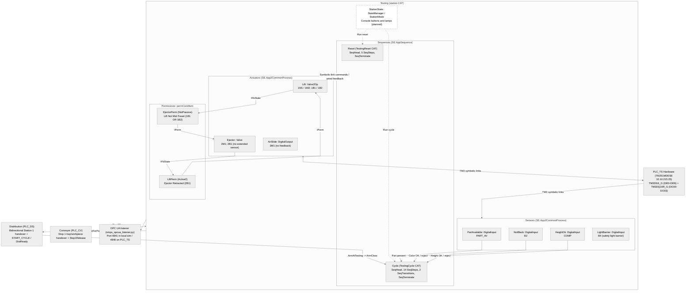
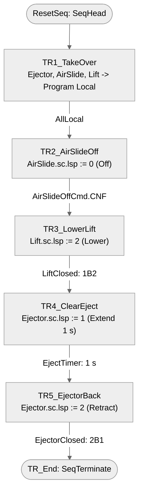
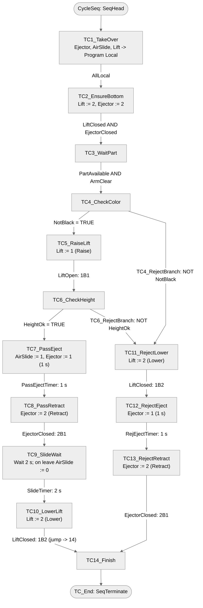

# Festo MPS 400 — Testing Station (`Testing`)

| Property | Value |
| --- | --- |
| **Station** | Testing (Station 1, Interface 1 — receives workpieces from Distributing, checks color & height, passes to air slide or rejects at bottom) |
| **Station CAT** | `Testing` (contains `TestingReset` and `TestingCycle` sub-CATs) |
| **Solution / Device** | `nmps/nmps.sln` → `Testing` (`M251_dPAC` / `TM251MDESE`, resource `RES0`) |
| **Controller & IP** | `PLC_TS` (`10.10.215.25`, `TM3DI16_G` + `TM3DQ16R_G`) — see [HARDWARE.md](HARDWARE.md) |
| **Reference GRAFCET** | [02_Testing_GRAFCET.pdf](grafcets/02_Testing_GRAFCET.pdf) |
| **Libraries** | `SE.App2CommonProcess`, `SE.App2Base`, `SE.AppSequence` (`25.0.1.5`); `Runtime.Base` (`25.0.1.2`); `SE.IoTMx` (`25.0.1.4`); `SE.DPAC` (`25.0.1.10`) |
| **Status** | Implemented, bound to `PLC_TS` TM3 I/O, wired to `Distribution` and `Conveyor` (with `Station1Coord` + HMI `Auto S1` / `Auto-Rel`), and verified standalone/with `Distribution` in EAE Local Simulation (3-PLC commissioning with `PLC_CV` pending) |

---

## 1. Overview & Status

This document describes the modular rebuild of the Festo MPS 400 Testing station control software in EcoStruxure Automation Expert (EAE) 25, following the standard-library architecture established for [Distribution](DISTRIBUTION.md). Instead of porting custom basic function blocks from the legacy nxtStudio program, the `Testing` Composite Automation Type (CAT) assembles unmodified Schneider Electric `SE.App2CommonProcess` and `SE.AppSequence` library blocks with built-in HMI faceplates, alarm handling, owner management, feedback monitoring, and OPC UA support.

Starting with Testing, sequence sub-CATs are prefixed with the machine name (`TestingReset` and `TestingCycle`) so the pattern scales cleanly across all remaining stations. The station's seven device blocks, two `permCondItem` permissives, 5-step `TestingReset`, 14-step branching `TestingCycle` (with the `Valve2Op` `AllLocal` `$IN3 = TRUE` fix applied), `Testing.RES0` startup chain, `TM3DI16_G`/`TM3DQ16R_G` I/O bindings, Topology logical-device link (`10.10.215.25`), OPC UA port `4841` for dual-device local simulation, and `Testing` HMI canvas are implemented and verified in EAE Local Simulation alongside [Distribution](DISTRIBUTION.md) (`FreeForPart` → `Distribution.DownstreamFree` and `Distribution.ArmAtTesting` → `ArmClear` gating `TC3_WaitPart`), monitored via [`nmps_opcua_listener.py`](../nmps_opcua_listener.py). Physical commissioning on `PLC_TS` remains to be completed.

---

## 2. Architecture & Design

`Testing` follows the same three engineering rules as [Distribution](DISTRIBUTION.md):

1. **Use library blocks unmodified:** Instantiate `SE.App2CommonProcess`, `SE.App2Base`, and `SE.AppSequence` blocks unchanged.
2. **Compose by wiring:** Express station safety (`LiftPerm`, `EjectorPerm`) and workflow (`TestingReset`, `TestingCycle`) through explicit signal, adapter, and sequence connections.
3. **Minimal custom glue logic:** Only add standard basic logic/timer FBs (`AND`, `NOT`, `ANY2ANY`, `E_DELAY`, `E_SR`) where a step condition, timed pulse, or VTQ conversion requires it.

*Figure 1. Architecture of the `Testing` CAT. Solid blocks are implemented, bound to `PLC_TS` I/O, and wired for bidirectional `Distribution` handover, `Conveyor` Stop 1 coordination, and OPC UA monitoring; the dashed block represents the planned console/supervisory extension.*

- **Resource startup chain (`RES0`):** Inside [`454CB27F11C39A4C.sysres`](../nmps/IEC61499/System/0c9a2a54-81d8-4cd3-8b56-539d6ba31ede/9b129585-0c86-45b1-8b59-a88961e02156/454CB27F11C39A4C.sysres), `START.COLD` and `START.WARM` initialize `FB1` (`DPAC_FULLINIT`), whose `INITO` initializes and triggers `SeqInit` (`EVENTCHAINHEAD` named `'SEQ_INIT'`); `SeqInit.FINISHED` initializes the `Testing` instance (`Testing.INIT`). `START.ONLINECHANGE` re-triggers the same chain via `OC_RETRIGGER` / `OC_DONE`.
- **Instance naming requirement:** Because `TestingReset` and `TestingCycle` address actuators via `'RES0.Testing.<Device>.sc.*'`, the `Testing` CAT instance mapped onto `Testing.RES0` must be named `Testing`.
- **Station 1 ↔ Conveyor Coordinator ([`Station1Coord`](../nmps/IEC61499/Station1Coord.fbt)):** [`Testing.fbt`](../nmps/IEC61499/Testing/Testing.fbt) also hosts `Coord` (`Station1Coord`), two `SetBool` toggles (`AutoMode` default `OFF`, `AutoRelease` offline default `TRUE` in [`Testing_CAT.offline.xml`](../nmps/IEC61499/Testing/Testing_CAT.offline.xml)), and two `T#500ms` `E_DELAY` timers (`TraySettleTimer` and `RelClearTimer`). `TestingCycle` exposes `PROG_START`, `CYCLE_STATE` (`TestStopped`, `TestComplete`), and `LastPass` (`PassResultLatch` `E_SR`: set at `TC10_LowerLift`, reset at `TC1_TakeOver` and `TC11_RejectLower`). When `Auto S1` is `ON` and `CycleSeq` on both `Distribution` and `Testing` are in `Program / Auto` mode:
  1. An arriving tray (`Stop1Tray = TRUE`) waits `500 ms` (`TraySettleTimer`) so `M1.DI05` (`Stop1Workpiece`) has settled before deciding.
  2. If the Station 1 pocket is empty (`NOT Stop1Workpiece`) and `Distribution` reports `DistReady = TRUE`, `Coord` fires `START_BOTH` (`Cycle.PROG_START` + `START_DIST`).
  3. If `Testing` takes a reject branch (`LastPass = FALSE`), Stopper 1 stays UP (`Stop1Release = FALSE`) and `Coord` immediately loops to serve another workpiece once `DistReady = TRUE`.
  4. When `Testing` passes (`LastPass = TRUE` and `Stop1Workpiece = TRUE`)—or a tray arrives with `Stop1Workpiece` already `TRUE`—and `AutoRelease` is `ON`, `Coord` sets `Stop1Release := TRUE` until `Stop1Tray` clears plus `500 ms` (`RelClearTimer`), then returns `Stop1Release := FALSE`.
- **HMI canvas (`Testing`):** [`Testing.cnv.Designer.cs`](../nmps/HMI/Testing.cnv.Designer.cs) (`1808 x 704`) hosts faceplates/symbols for all seven devices (`Lift`, `Ejector`, `AirSlide`, `PartAvailable`, `NotBlack`, `HeightOk`, `LightBarrier`), both sequence heads (`ResetSeq` and `CycleSeq` via `SE.AppSequence.Symbols.SeqHead.sHead`), an `AlarmGrid` control, and the `Station 1 <-> Conveyor Auto Mode` panel (`Auto S1: OFF/ON`, `Auto-Rel: ON/OFF`).

---

## 3. Hardware & I/O Mapping

For controller specifications, Ethernet addressing, TM3 wiring conventions, and EISLAB rewiring notes, see [HARDWARE.md](HARDWARE.md).

### Devices & Library Configuration

| Device instance | Library type | Physical signals | Key configuration & notes |
| --- | --- | --- | --- |
| `Lift` | `SE.App2CommonProcess.Valve2Op` | Coils `1M1`, `1M2`; switches `1B1`, `1B2` | Vertical lifting cylinder (`1A1`). `Open = 1` (`1M2` raises → `1B1` / `fbOpen`); `Close = 2` (`1M1` lowers → `1B2` / `fbClose`); `Stop = 0` (neither coil energized, mid-travel). |
| `Ejector` | `SE.App2CommonProcess.Valve` | Coil `2M1`; switch `2B1` | Single-coil ejecting cylinder (`2A1`) with **only** a retracted sensor (`2B1` → `fbClose`) and no extended sensor. Keeps default `FbMode = 16#0` so `2B1` is monitored on retract (`FbClosed = TRUE` at rest); sequences pulse `Open = 1` for `T#1s` via `E_DELAY` + `E_SR` before retracting. |
| `AirSlide` | `SE.App2CommonProcess.DigitalOutput` | Coil `3M1` | Air-cushion slide (`3A1`) with no sensor feedback; enabled during pass ejection (`TC7_PassEject`) through `TC9_SlideWait` (`T#2s`), turned off on `TC9_SlideWait.STEP_LEAVE` and during reset (`TR2_AirSlideOff`). |
| `PartAvailable` | `SE.App2CommonProcess.DigitalInput` | Sensor `PART_AV` | Capacitive proximity sensor; `TRUE` when a workpiece sits at the bottom of the lift. |
| `NotBlack` | `SE.App2CommonProcess.DigitalInput` | Sensor `B2` | Optical diffuse sensor; `TRUE` when the workpiece is **not black** (red or metallic). |
| `LightBarrier` | `SE.App2CommonProcess.DigitalInput` | Sensor `B4` | Retro-reflective safety light barrier across the measuring area (currently monitored on HMI; not yet wired as a cycle interlock). |
| `HeightOk` | `SE.App2CommonProcess.DigitalInput` | Comparator `COMP` | Digital OK output from the analog displacement height sensor (`R1`) and comparator (`I3`). `TRUE` when workpiece height at the top of the lift is within tolerance. |

### Physical TM3 I/O Binding (`PLC_TS`)

Bound in [`9b129585-0c86-45b1-8b59-a88961e02156.hcf`](../nmps/IEC61499/System/0c9a2a54-81d8-4cd3-8b56-539d6ba31ede/9b129585-0c86-45b1-8b59-a88961e02156/9b129585-0c86-45b1-8b59-a88961e02156.hcf) (`TM3DI16_G` + `TM3DQ16R_G`):

| TM3 Channel | Festo Tag | Signal Description | EAE Symbolic Link Target (`RES0.Testing...`) |
| --- | --- | --- | --- |
| `DI00` | `PART_AV` | Workpiece available (capacitive proximity sensor) | `PartAvailable.pv` (`C100000000000004.6.DIn`) |
| `DI01` | `B2` | Workpiece is not black (diffuse optical sensor) | `NotBlack.pv` (`C100000000000005.6.DIn`) |
| `DI02` | `B4` | Safety light barrier | `LightBarrier.pv` (`C100000000000006.6.DIn`) |
| `DI03` | `COMP` | Workpiece height correct (comparator OK) | `HeightOk.pv` (`C100000000000007.6.DIn`) |
| `DI04` | `1B1` | Lifting cylinder raised (at top) | `Lift.fbOpen` (`C100000000000001.9.DIn`) |
| `DI05` | `1B2` | Lifting cylinder lowered (at bottom) | `Lift.fbClose` (`C100000000000001.15.DIn`) |
| `DI06` | `2B1` | Ejecting cylinder retracted | `Ejector.fbClose` (`C100000000000002.21.DIn`) |
| `DI07` | `IP_FI` | Downstream station free (optical link receiver) | *(unbound)* |
| `DO00` | `1M1` | Lower lifting cylinder | `Lift.cmdClose` (`C100000000000001.16.DOut`) |
| `DO01` | `1M2` | Raise lifting cylinder | `Lift.cmdOpen` (`C100000000000001.11.DOut`) |
| `DO02` | `2M1` | Extend ejecting cylinder | `Ejector.cmd` (`C100000000000002.15.DOut`) |
| `DO03` | `3M1` | Air slide on | `AirSlide.value` (`C100000000000003.5.DOut`) |
| `DO07` | `IP_N_FO` | Station occupied (optical link transmitter) | *(unbound)* |

*Note:* `DI08`–`DI11` and `DO08`–`DO11` correspond to the Festo operator console (`XMG1`: `S1`–`S4`, `P1`–`P4`) and remain unbound until console/supervisory logic is added.

### Permissives (`permCondItem`)

| Instance | Target `IPerm` | Feedback Source | Parameters | Purpose |
| --- | --- | --- | --- | --- |
| `LiftPerm` | `Lift.IPerm` | `Ejector.IFbState` | `$CondCause = Active2`, `$CondPos = Active1`, `$CondName = 'Ejector Retracted'` | Permits `Lift` to raise (`1M2`) only while `Ejector` is confirmed retracted (`2B1` / `Active2`), preventing mechanical collisions. |
| `EjectorPerm` | `Ejector.IPerm` | `Lift.IFbState` | `$CondCause = NotPassive`, `$CondPos = Active1`, `$CondName = 'Lift Not Mid-Travel'` | Permits `Ejector` to extend (`2M1`) when `Lift` is at either end position (`1B1` top for pass, `1B2` bottom for reject/reset), blocking extension while `Lift` is stopped mid-travel (`Passive = 0`). |

---

## 4. Control Sequences

Both sequences use `SE.AppSequence` (`SeqHead`, `SeqStep`, `SeqTransition`, `SeqTerminate`) inside dedicated sub-CATs ([`TestingReset.fbt`](../nmps/IEC61499/TestingReset/TestingReset.fbt) and [`TestingCycle.fbt`](../nmps/IEC61499/TestingCycle/TestingCycle.fbt)), following the EISLAB Testing workflow (color check at bottom, height check at top, pass via air slide, reject at bottom; see [02_Testing_GRAFCET.pdf](grafcets/02_Testing_GRAFCET.pdf) for the Festo reference).

- **Command & timer mechanics:** Each step writes VTQ setpoints (`0`/`1`/`2`) or `progLocalSel := TRUE` via `SYMLINKMULTIVARSRC` paired with `ANY2ANY` constants (`IN1=TRUE`, `IN2=1`, `IN3=2`, `IN4=0`). Because `Ejector` has no extended limit switch, each eject step uses its own `E_DELAY` (`T#1s`) + `E_SR` latch triggered from `STEP_ENTER` (and reset/stopped on `STEP_LEAVE`), preventing cross-talk between pass and reject ejections.

### 4.1 Reset Sequence (`TestingReset`)

| Step ID | Action (`SYMLINKMULTIVARSRC`) | Transition Condition (`Exceeded`) | Notes |
| --- | --- | --- | --- |
| `TR1_TakeOver` | `Ejector`, `AirSlide`, `Lift` → `sc.progLocalSel := TRUE` | `AllLocal` (`Ejector AND AirSlide AND TRUE`) | Switches actuators to `Program Local`; `Lift` (`Valve2Op`) `sc.progLocal` input is bypassed (`$IN3 = TRUE`, see Section 6 #2). |
| `TR2_AirSlideOff` | `AirSlide.sc.lsp := 0` (`Off`) | `$Exceeded = TRUE` | Immediately disables the air slide on `AirSlideOffCmd.CNF`. |
| `TR3_LowerLift` | `Lift.sc.lsp := 2` (`Close` / Lower) | `LiftClosed` (`1B2`) | Lowers the lifting cylinder to the bottom position. |
| `TR4_ClearEject` | `Ejector.sc.lsp := 1` (`Open` / Extend) | `EjectLatch.Q` (`EjectTimer` `T#1s`) | Pulses the ejector at the bottom to clear any leftover workpiece off the lift. |
| `TR5_EjectorBack` | `Ejector.sc.lsp := 2` (`Close` / Retract) | `EjectorClosed` (`2B1`) | Retracts the ejector back to rest (`2B1`). |

*Figure 2. `TestingReset` (5 steps, clearing any workpiece at the bottom and returning to rest).*

### 4.2 Automatic Cycle (`TestingCycle`)

`TestingCycle` evaluates color (`NotBlack`) at the bottom before lifting, and height (`HeightOk`) at the top. Both reject checks use `SE.AppSequence.SeqTransition` (`$TransNextStepId = "11"`) to branch to `TC11_RejectLower`, which guarantees the lift is lowered before ejecting a rejected workpiece at the bottom. On the pass branch, `TC10_LowerLift` uses `$TransStepId = "14"` to skip steps 11–13 directly to `TC14_Finish`.

| Step ID | Action (`SYMLINKMULTIVARSRC`) | Transition Condition (`Exceeded`) | Next Step |
| --- | --- | --- | --- |
| `TC1_TakeOver` | `Ejector`, `AirSlide`, `Lift` → `sc.progLocalSel := TRUE` | `AllLocal` (`Ejector AND AirSlide AND TRUE`) | `2` (`TC2_EnsureBottom`) |
| `TC2_EnsureBottom` | `Lift.sc.lsp := 2`, `Ejector.sc.lsp := 2` | `AtBottomReady` (`LiftClosed AND EjectorClosed`) | `3` (`TC3_WaitPart`) |
| `TC3_WaitPart` | None (wait step) | `PartAndArmClear` (`PartAvailable AND ArmClear`, where `ArmClear = NOT ArmAtTesting` from `Distribution`; defaults `TRUE` standalone) | `4` (`TC4_CheckColor`) |
| `TC4_CheckColor` | None (decision step) | Pass: `NotBlack` (`B2`) / Reject (`TC4_RejectBranch`): `IsBlack` (`NOT NotBlack`) | Pass: `5` (`TC5_RaiseLift`) / Reject: `11` (`TC11_RejectLower`) |
| `TC5_RaiseLift` | `Lift.sc.lsp := 1` (`Open` / Raise) | `LiftOpen` (`1B1`) | `6` (`TC6_CheckHeight`) |
| `TC6_CheckHeight` | None (decision step) | Pass: `HeightOk` (`COMP`) / Reject (`TC6_RejectBranch`): `BadHeight` (`NOT HeightOk`) | Pass: `7` (`TC7_PassEject`) / Reject: `11` (`TC11_RejectLower`) |
| `TC7_PassEject` | `AirSlide.sc.lsp := 1`, `Ejector.sc.lsp := 1` | `PassEjectLatch.Q` (`PassEjectTimer` `T#1s`) | `8` (`TC8_PassRetract`) |
| `TC8_PassRetract` | `Ejector.sc.lsp := 2` (`Close`) | `EjectorClosed` (`2B1`) | `9` (`TC9_SlideWait`) |
| `TC9_SlideWait` | Hold `AirSlide` on; on `STEP_LEAVE`: `AirSlide.sc.lsp := 0` | `SlideLatch.Q` (`SlideTimer` `T#2s`) | `10` (`TC10_LowerLift`) |
| `TC10_LowerLift` | `Lift.sc.lsp := 2` (`Close` / Lower) | `LiftClosed` (`1B2`) | `14` (`TC14_Finish`, skips 11–13) |
| `TC11_RejectLower` | `Lift.sc.lsp := 2` (`Close` / Lower) | `LiftClosed` (`1B2`) | `12` (`TC12_RejectEject`) |
| `TC12_RejectEject` | `Ejector.sc.lsp := 1` (`Open` / Extend) | `RejEjectLatch.Q` (`RejEjectTimer` `T#1s`) | `13` (`TC13_RejectRetract`) |
| `TC13_RejectRetract` | `Ejector.sc.lsp := 2` (`Close` / Retract) | `EjectorClosed` (`2B1`) | `14` (`TC14_Finish`) |
| `TC14_Finish` | None (merge step) | `$Exceeded = TRUE` | `15` (`TC_End`) |

*Figure 3. `TestingCycle` (14 steps with color and height `SeqTransition` reject branches merging into `TC11_RejectLower` → `TC14_Finish`).*

### 4.3 Supervisory State Management (Planned)

`Testing` will share the same supervisory station state layer (`StateManager` or a compact 4-state `StationMode` FB) described in [DISTRIBUTION.md](DISTRIBUTION.md#43-supervisory-state-management-planned--optional) once console I/O and Station 1 handover logic are integrated.

---

## 5. Commissioning & Verification

### 5.1 Local Simulation Test Plan

1. Open `nmps/nmps.sln` in EAE 25, ensure **Navigation Bar** is enabled on the `800x480` HMI resolution (or launch the `Testing` canvas directly), and run **Build** and **Build HMI**.
2. In **Deploy and Diagnostic**, set **Active Network Profile** to `Local Test`, start Runtime Simulation for `Testing` (`Deploy = 51499`, `Archive = 51496`, OPC UA port `4841` so it can run alongside `Distribution` on `4840`), log in (`aic3`), and run **Deploy**.
3. Open the `Testing` HMI canvas, enable **Simulation** on `Lift` and `Ejector` faceplates, and press **Rearm** if startup feedback alarms appeared before Simulation was enabled. Optionally run [`nmps_opcua_listener.py`](../nmps_opcua_listener.py) (`python nmps_opcua_listener.py --csv sim_test.csv`) to trace all three stations (`Distribution`, `Testing`, and `Conveyor`, including `Testing.AutoMode.bitState` and `Testing.AutoRelease.bitState`) concurrently.

| # | Test Scenario | Expected Outcome | Status |
| --- | --- | --- | --- |
| 1 | **Manual actuator control.** Switch Owner to `Operator` on `Lift`, `Ejector`, and `AirSlide`; test `Open` / `Close` (`Stop` on `Lift`). | `Lift` transitions `Opening → Open → Closing → Closed` (`Stopped` mid-travel); `Ejector` and `AirSlide` respond on HMI. | Passed |
| 2 | **`LiftPerm` (`Ejector Retracted`).** Extend `Ejector` (`Open`), then try to raise `Lift`; retract `Ejector` and retry. | `Lift` raise is blocked (`⊘` badge, `Ejector Retracted` red) until `Ejector` is confirmed retracted (`2B1`). | Pending |
| 3 | **`EjectorPerm` (`Lift Not Mid-Travel`).** Stop `Lift` mid-travel (`FbStopped = TRUE`) and try to extend `Ejector`; move `Lift` to `Open` or `Closed` and retry. | `Ejector` extend is blocked while `Lift` is `Passive` (stopped mid-travel), and allowed at both top (`1B1`) and bottom (`1B2`). | Pending |
| 4 | **5-step `ResetSeq`.** Return device owners to `Program`, start `ResetSeq` in `Operator` mode. | `AirSlide` turns off, `Lift` lowers (`1B2`), `Ejector` pulses `1 s`, retracts (`2B1`), and `ResetSeq` completes. | Passed |
| 5 | **Pass cycle (`TestingCycle`).** Override `PartAvailable = True`, `NotBlack = True`, `HeightOk = True`, run `CycleSeq`. | Executes `TC1`–`TC10` → `TC14` (skips `TC11`–`TC13`): lifts, turns on `AirSlide` + `Ejector` (`1 s`), retracts `Ejector`, holds `AirSlide` (`2 s`), lowers `Lift`, completes. | Passed |
| 6 | **Color-reject branch.** Override `PartAvailable = True`, `NotBlack = False`, run `CycleSeq`. | Branches at `TC4_RejectBranch` directly to `TC11_RejectLower` (never raises lift), pulses `Ejector` (`1 s`), retracts, completes. | Passed |
| 7 | **Height-reject branch.** Override `PartAvailable = True`, `NotBlack = True`, `HeightOk = False`, run `CycleSeq`. | Raises lift (`TC5`), branches at `TC6_RejectBranch` to `TC11_RejectLower` (lowers lift first), pulses `Ejector` (`1 s`), retracts, completes. | Passed |
| 8 | **Cross-station handover with `Distribution`.** Run both stations; toggle `PartAvailable = True` while `Distribution.Swivel` is still at `3B2` (`AC9_DropOff`), then step `Distribution` to `AC10`. | `FreeForPart` sets `Distribution.DownstreamFree = False`, `Distribution` still completes `AC10`–`AC12` mid-park, and `ArmAtTesting` holds `TC3_WaitPart` until `Swivel` leaves `3B2`. | Passed |

### 5.2 Physical PLC Deployment Checklist (`PLC_TS`, `10.10.215.25`)

1. Ensure the engineering PC Ethernet adapter is on `10.10.0.20` / `255.255.0.0` (no gateway) and **Active Network Profile** in EAE is `(Default)`.
2. Verify `Testing` (`10.10.215.25`) in [`Equipment_Testing.json`](../nmps/Topology/Equipment_Testing.json) is bound to logical device `Testing` (`9b129585-0c86-45b1-8b59-a88961e02156`) and [`9b129585-0c86-45b1-8b59-a88961e02156.hcf`](../nmps/IEC61499/System/0c9a2a54-81d8-4cd3-8b56-539d6ba31ede/9b129585-0c86-45b1-8b59-a88961e02156/9b129585-0c86-45b1-8b59-a88961e02156.hcf) uses **`TM3DQ16R_G`** with `DI00`–`DI06` and `DO00`–`DO03` bound.
3. **OPC UA port check:** `Testing` device properties currently set `endpoints/0/bind_port = 4841` for dual-device local simulation. When deploying to physical `PLC_TS`, either revert `bind_port` to `4840` or pass `--mode lab --test-url opc.tcp://10.10.215.25:4841` to [`nmps_opcua_listener.py`](../nmps_opcua_listener.py).
4. If the M251 dPAC shield icon is empty red (*Security Not Set*), run **Configure Security** first with factory default credentials (`User: installer`, `Password: Inst@ller1`), click **Trust**, then log in as `aic3`.
5. Run **Deploy**, ensure **Simulation** is off on all `Testing` actuator faceplates, verify compressed air is connected, and test manual actuation followed by `ResetSeq` and `CycleSeq` with black, non-black pass, and wrong-height workpieces.

---

## 6. Problems, Caveats & Notes

1. **`Ejector` has no extended limit switch (`2B1` only).**
   Unlike `Distribution.Ejector` (`1B1`/`1B2`), `Testing.Ejector` (`2A1`) only has retracted switch `2B1`.
   *Solution:* Keep default `FbMode = 16#0` so `2B1` stays monitored on retract, and time each extend pulse (`T#1s`) with dedicated `E_DELAY` + `E_SR` pairs (`EjectTimer`, `PassEjectTimer`, `RejEjectTimer`) triggered from each step's `STEP_ENTER` (not a shared command `CNF`) to prevent timer cross-talk.
2. **`Valve2Op` (`Lift`) `sc.progLocal` library bug (`SE.App2CommonProcess` 25.0.1.5).**
   As discovered on `Distribution.Swivel` ([DISTRIBUTION.md](DISTRIBUTION.md#6-problems--solutions)), `Valve2Op`'s internal `sc.progLocal` reader leaves `$QI` unset and never publishes `progLocal = TRUE` back to sequences.
   *Resolved:* Replaced `OwnerFb.VALUE3` with `<Parameter Name="$IN3" Value="TRUE" />` on `AllLocal` in both [`TestingReset.fbt`](../nmps/IEC61499/TestingReset/TestingReset.fbt) and [`TestingCycle.fbt`](../nmps/IEC61499/TestingCycle/TestingCycle.fbt), while continuing to write `Lift.sc.progLocalSel := TRUE`. Ensure `Lift`'s HMI owner switch is set to `Program` before running sequences (`sc.progLocalSel` cannot override `Operator` mode).
3. **Startup `Detected Feedback Failure` on `Lift` and `Ejector` in Local Simulation.**
   Observed in the HMI Alarm Grid on initial simulation start because `DI04`–`DI06` start `FALSE` while actuators are not yet in faceplate Simulation mode.
   *Solution:* Enable **Simulation** on the `Lift` and `Ejector` faceplates, click **Rearm**, and run `ResetSeq`.
4. **HMI navigation between `Distribution` and `Testing` (`Start Local HMI`).**
   In [`CanvasesResolutionList.xml`](../nmps/HMI/CanvasesResolutionList.xml), the `800x480` resolution had `NavigationBar="false"`, causing `StartCanvas_2` to omit the top navigation header and show only the first canvas (`Distribution`).
   *Solution:* Enable **Navigation Bar** in `800x480` properties in EAE (and rebuild HMI) so operators can switch between `Distribution` and `Testing` from the navigation bar.
5. **Height checker (`COMP`) hardware uncertainty.**
   If the physical analog height sensor/comparator on the EISLAB Testing rig is out of calibration or faulty, `TC6_CheckHeight` will route every lifted workpiece to `TC6_RejectBranch` (`HeightOk = FALSE`).
   *Workaround:* Use the `HeightOk` HMI faceplate **Override** to force `True`/`False` during commissioning until the physical comparator threshold is verified.
6. **Handover collision guard (`ArmAtTesting` / `ArmClear`) & EAE `.syslay` reload caveat.**
   At `AC9_DropOff`, the falling workpiece can assert `PartAvailable` while `Distribution`'s swivel arm is still over `Testing`'s lift at `3B2`. `TestingCycle` now gates `TC3_WaitPart` on `PartAvailable AND ArmClear` (with `ArmAtTesting` defaulting to `FALSE` standalone, and without wiring `ArmClear.CNF` back to `REQ_ARM_POS` to avoid an infinite cross-PLC loop). Note that an Operator manually switching `Lift` to `Operator` and pressing `Open` is not yet blocked by a `permCondItem` for `ArmClear`. Also, after editing cross-device wires externally in [`6176bcc6-dc42-44e0-920e-ad204ed015ce.syslay`](../nmps/IEC61499/System/0c9a2a54-81d8-4cd3-8b56-539d6ba31ede/9bf3b433-92e3-4d31-8cff-c20036297fe9/6176bcc6-dc42-44e0-920e-ad204ed015ce.syslay), close and reopen `nmps.sln` and run **Rebuild** in EAE so the cross-PLC communication descriptors (`commdesc.xml`) are regenerated.
7. **Dual-station local simulation OPC UA port (`4840` collision).**
   When simulating both `Distribution` and `Testing` on `127.0.0.1`, whichever device starts first binds OPC UA port `4840`. Setting `Testing` device property `endpoints/0/bind_port = 4841` separates the two servers so [`nmps_opcua_listener.py`](../nmps_opcua_listener.py) can stream both concurrently (`127.0.0.1:4840` and `127.0.0.1:4841`).

---

## 7. Remaining Work

- **Permissive & physical hardware verification:** Verify `LiftPerm` and `EjectorPerm` in simulation/lab, optionally add a `permCondItem` on `Lift.IPerm` blocking manual `Operator` raises while `ArmAtTesting = TRUE`, and run physical `PLC_TS` + `PLC_DS` commissioning (including verifying `COMP` height comparator settle timing).
- **Conveyor (`PLC_CV`) / tray integration (`Station1Coord`):** Handover wiring between `Conveyor` (`PLC_CV`, `10.10.215.19`) Stop 1 (`Stop1Tray`, `Stop1Workpiece`, `Stop1Release`), `Distribution` (`START_CYCLE`, `DIST_READY_CNF`), and `Testing` ([`Station1Coord`](../nmps/IEC61499/Station1Coord.fbt) + HMI `AutoMode` / `AutoRelease`) is implemented in [`6176bcc6-dc42-44e0-920e-ad204ed015ce.syslay`](../nmps/IEC61499/System/0c9a2a54-81d8-4cd3-8b56-539d6ba31ede/9bf3b433-92e3-4d31-8cff-c20036297fe9/6176bcc6-dc42-44e0-920e-ad204ed015ce.syslay); run **Rebuild** + **Deploy** across all three PLCs and test with `CycleSeq` in `Program / Auto` mode.
- **Console I/O & OPC UA:** Bind `DI08`–`DI11` / `DO08`–`DO11` console channels when the supervisory state layer is added, and verify OPC UA variable exposure within the M251 dPAC node budget.
