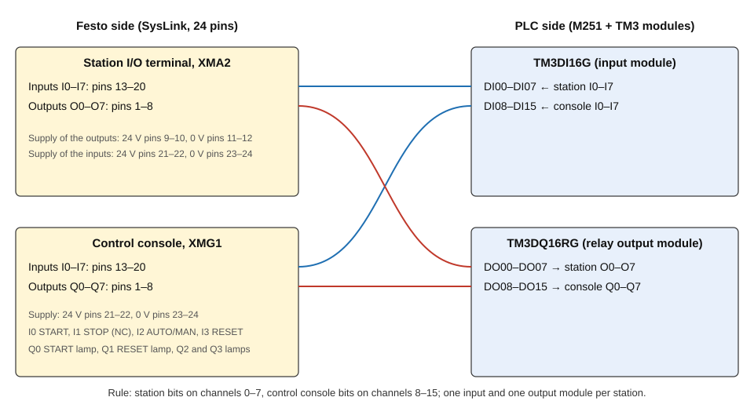
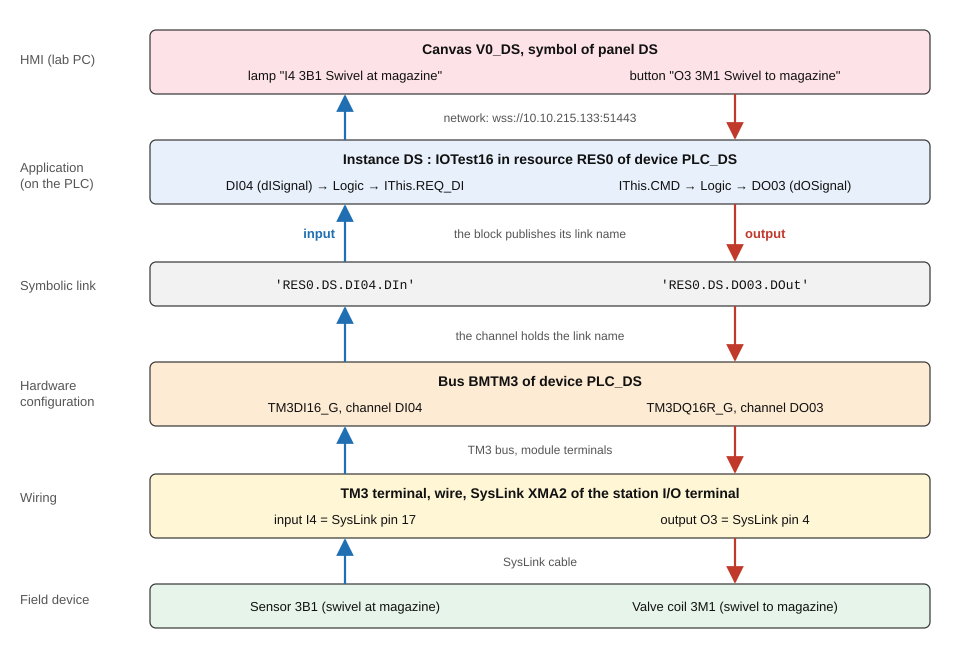
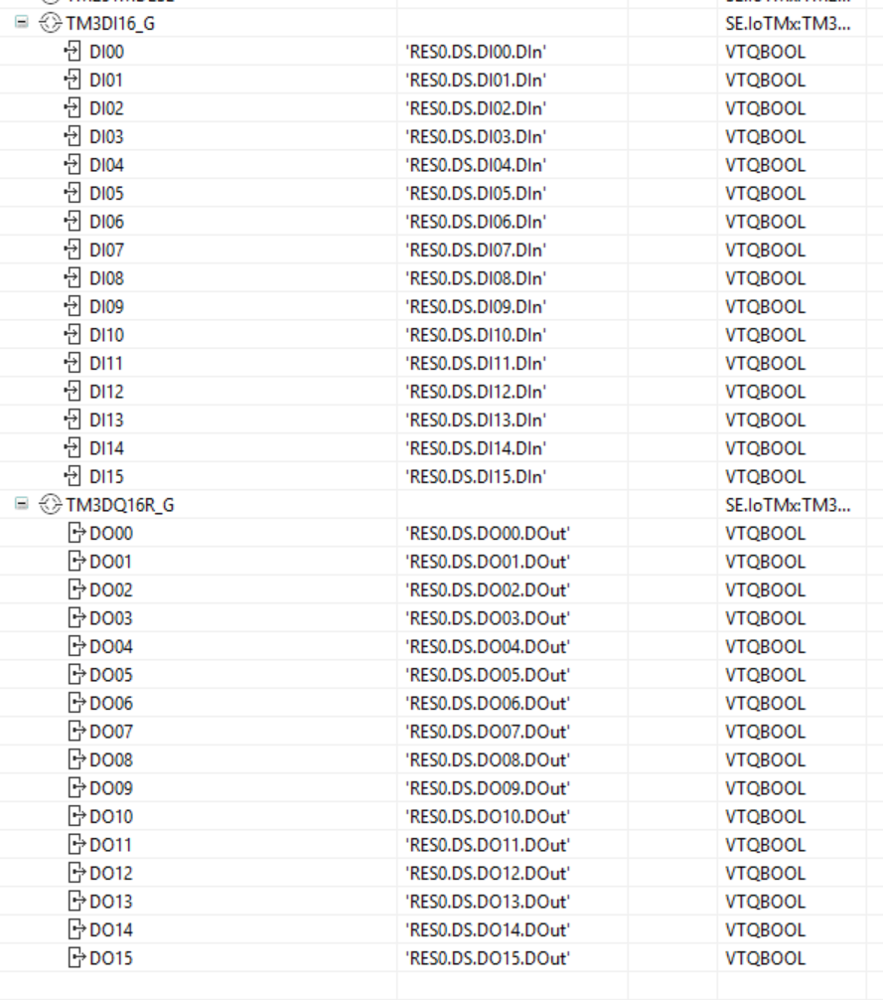
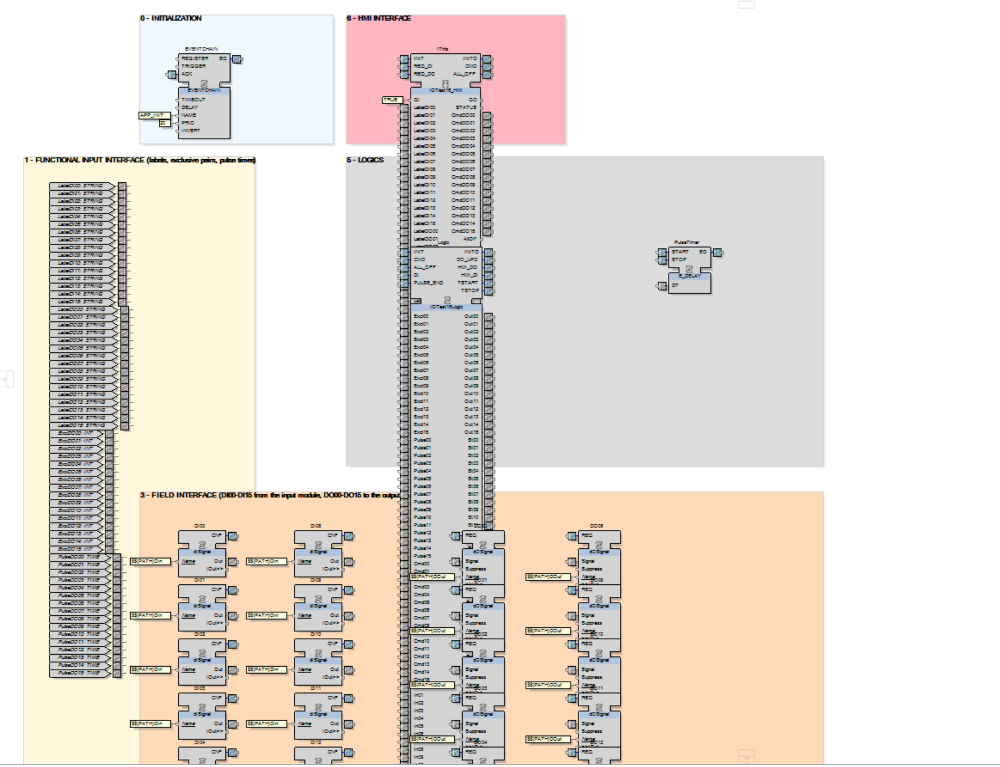
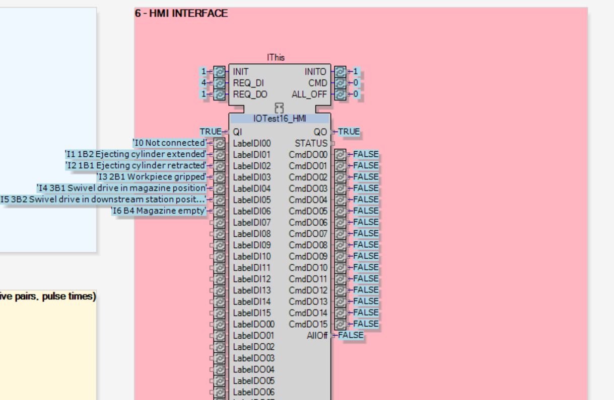
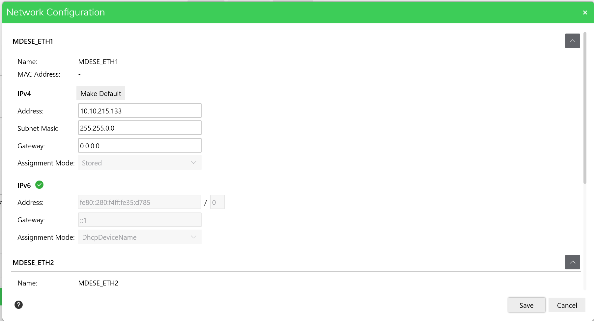
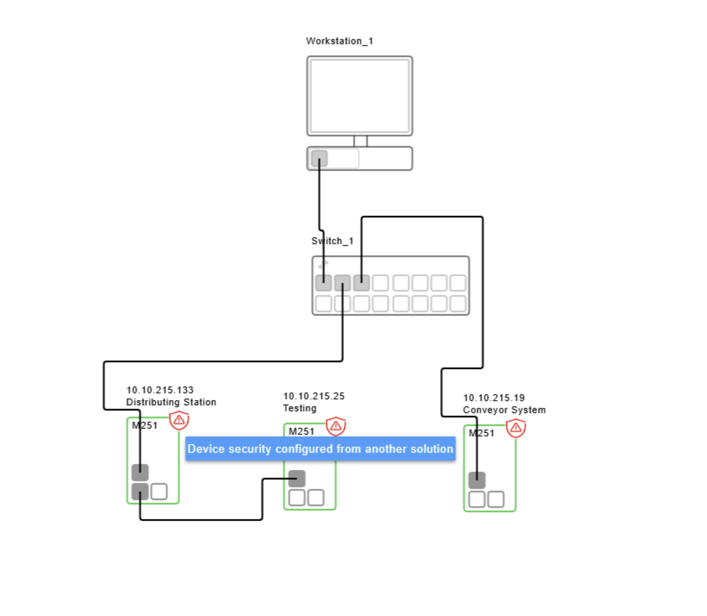
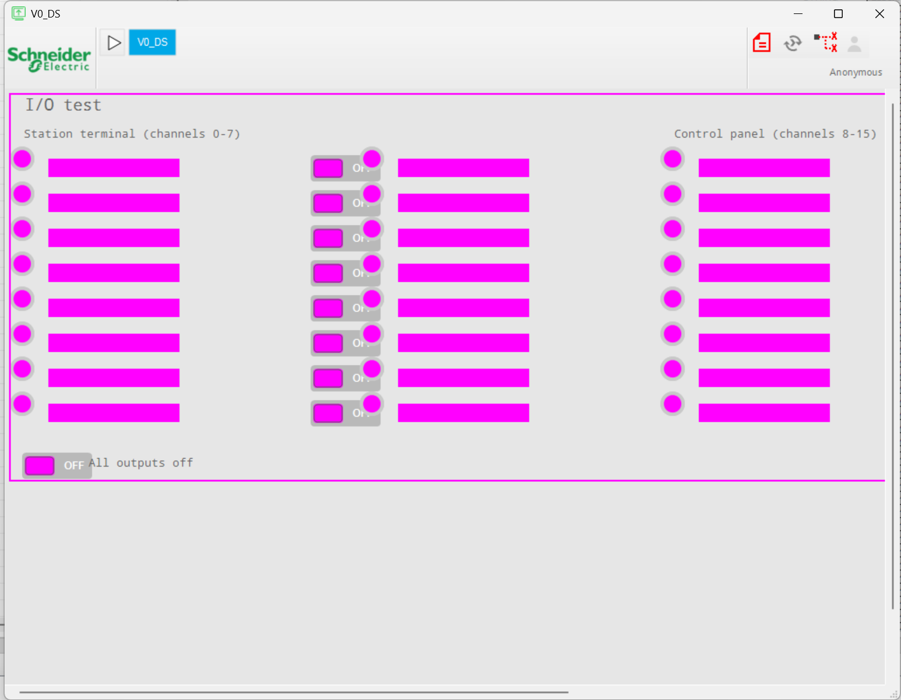
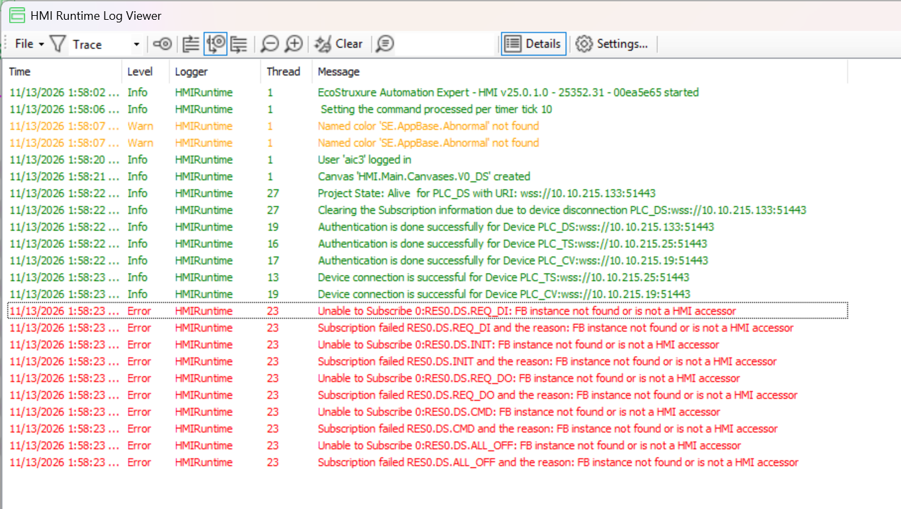
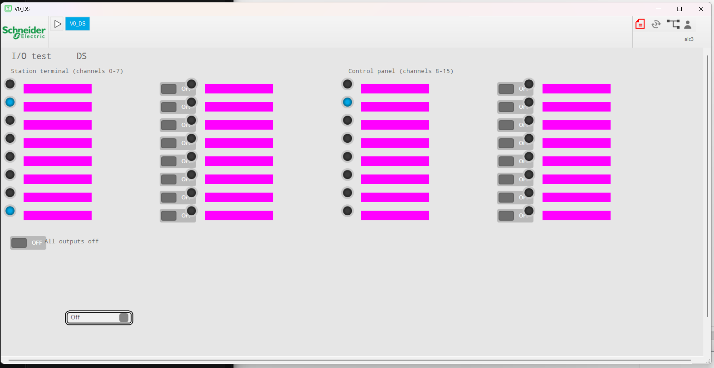

# MPS 400 I/O commissioning: from the wire to the HMI

*Knowledge transfer for the student team. Luleå University of Technology, Festo MPS 400 lab. Work done with Flexbridge AB. Version of 2026-11-13.*

This document explains how we take the Festo MPS 400 from loose wires to a tested set of inputs and outputs that a PLC program can trust. It is also your **work instruction**: after reading it you can set up a PLC and test its stations yourselves.

The work has three steps:

1. **Wiring**: each station's Festo I/O connectors are wired to the TM3 I/O modules of a Schneider Electric M251 controller.
2. **Testing with a multimeter**: each wire is checked from end to end before any program is involved.
3. **Testing with the I/O test project**: a small EcoStruxure Automation Expert (EAE) application lets you switch every output and see every input from an HMI. It checks each channel through the whole chain: sensor → wire → module → PLC → network → screen, and back again.

The Distributing station (`DS`) is the worked example. It was the first station tested end to end, on 2026-11-13. The Testing station and the conveyor are set up the same way. **Your task** is the two PLCs that carry two stations each: Handling + Processing (`PLC_HP`) and Handling + Sorting (`PLC_HS`). Then you test all stations.

You may use the text, tables and figures in your reports. Please cite them as *"MPS 400 I/O commissioning: from the wire to the HMI, LTU / Flexbridge AB, 2026"*.

### Placeholders: your part of this document

This document is not finished. You complete it while you work, and the next group learns from what you add. There are two kinds of placeholder:

> 📷 **Picture task.** Take the photo or screenshot described, save it in `docs/version0/images/` under the given file name, and replace the box with the image line shown, plus a caption in italics below it.

> ✍️ **Fill in.** Write down what you found out or did, in your own words, in place of the box. If something differs from this document, write what you did instead. Corrections are welcome.

---

## Contents

1. [The plant and the controllers](#1-the-plant-and-the-controllers)
2. [Step 1: Wiring](#2-step-1-wiring)
3. [Step 2: Testing the wiring with a multimeter](#3-step-2-testing-the-wiring-with-a-multimeter)
4. [Step 3: How the I/O test project works](#4-step-3-how-the-io-test-project-works)
5. [Your task A: set up your PLC in EAE](#5-your-task-a-set-up-your-plc-in-eae)
6. [Your task B: test the stations](#6-your-task-b-test-the-stations)
7. [Problems we met and how we solved them](#7-problems-we-met-and-how-we-solved-them)
8. [Glossary](#8-glossary)
9. [References](#9-references)

---

## 1. The plant and the controllers

The MPS 400 is a modular production system. A conveyor loop carries workpieces on trays between stations: Distributing and Testing at interface 1, Handling and Processing at interface 2, Handling and Sorting at interface 6. Each station has its own Festo control console with START, STOP, RESET and an AUTO/MAN key switch.

The original Festo controllers were replaced by five **Schneider Electric M251 dPAC** controllers. Each one carries **TM3** expansion modules on its right side:

- **TM3DI16G**: 16 digital inputs, 24 V DC.
- **TM3DQ16RG**: 16 digital outputs with relay contacts.

| Controller | EAE device | Stations | Module pairs | IP address (ETH1) | Set up by |
|---|---|---|---|---|---|
| plc-distributing | `PLC_DS` | Distributing | 1 | 10.10.215.133 | example (done) |
| plc-testing | `PLC_TS` | Testing | 1 | 10.10.215.25 | example (done) |
| plc-conveyor | `PLC_CV` | Conveyors A+B, C+D | 2 | 10.10.215.19 | example (done) |
| plc-handling-processing | `PLC_HP` | Handling (interface 2), Processing | 2 | 10.10.215.21 | **students, pair 1** |
| plc-handling-sorting | `PLC_HS` | Handling (interface 6), Sorting | 2 | 10.10.214.251 | **students, pair 2** |

**How the IP address is formed.** Port ETH1, the one on the lab switch that EAE and the HMI use, has the address 10.10.XXX.YYY. XXX and YYY are the last two bytes of the PLC's MAC address, written in decimal. Example for Distributing: MAC …:D7:85 gives D7 = 215 and 85 = 133, so the address is 10.10.215.133. Port ETH2 follows the same rule with 10.11.XXX.YYY.

---

## 2. Step 1: Wiring

### 2.1 The Festo side: SysLink

Every Festo station has an **I/O terminal** with a 24-pin **SysLink** connector, `XMA2`, for 8 inputs and 8 outputs. The control console has a second SysLink connector, `XMG1`, with another 8 inputs and 8 outputs (the buttons, the key switch and the lamps). The pin assignment is the same on both:

| SysLink pins | Signal |
|---|---|
| 1–8 | Outputs O0–O7 (console: Q0–Q7) |
| 9–10 | 24 V supply for the outputs |
| 11–12 | 0 V for the outputs |
| 13–20 | Inputs I0–I7 |
| 21–22 | 24 V supply for the inputs (and the sensors) |
| 23–24 | 0 V for the inputs |

Source: Festo circuit diagrams on the MPS documentation CD, for example *Electric circuit diagram Distributing*, pages 3–5, and *Electric circuit diagram Control console*.

Festo sensors and valves are **positive switching (PNP)**. An active sensor puts +24 V on its input pin, and an output drives a valve coil by putting +24 V on the output pin.

### 2.2 The rule we wire by

One input module and one output module per station, always in the same order on the rail: input, output (and for a shared PLC: input, output, input, output).

*Figure 1: Channel map of one station. Station bits go on channels 0–7, control console bits on channels 8–15.*

So on the Distributing PLC, for example:

| TM3 channel | Comes from / goes to | Example |
|---|---|---|
| DI00–DI07 | Station inputs I0–I7 (XMA2 pins 13–20) | DI04 = I4 = sensor 3B1, swivel drive at magazine |
| DI08–DI15 | Console inputs I0–I7 (XMG1 pins 13–20) | DI08 = START button S1 |
| DO00–DO07 | Station outputs O0–O7 (XMA2 pins 1–8) | DO03 = O3 = valve coil 3M1, swivel to magazine |
| DO08–DO15 | Console outputs Q0–Q7 (XMG1 pins 1–8) | DO08 = START lamp P1 |

The full list per station, with the Festo symbol of every sensor and valve, is in `docs/mps400/wiring-check.xlsx` (one sheet per station) and in [instance-parameters.md](instance-parameters.md).

### 2.3 How we wired it

> 📷 **Picture task:** `images/photo-plc-rail.jpg`. The M251 with its TM3 modules, wired; the whole PLC in one picture.
> Replace with: ``

> 📷 **Picture task:** `images/photo-tm3-terminals.jpg`. Close-up of the input and output module terminals, so that the common (COM) and supply terminals can be read.
> Replace with: ``

> 📷 **Picture task:** `images/photo-syslink-connection.jpg`. How the SysLink cable reaches the module terminals.
> Replace with: ``

> ✍️ **Fill in:** how the SysLink cable is connected to the TM3 terminals (adapter, terminal block, cut cable, …).

> ✍️ **Fill in** the supply and common connections, with the terminal names from the module's hardware guide:
>
> | Connection | From (terminal name) | To |
> |---|---|---|
> | Input module common(s) | | 0 V or +24 V? |
> | Output module common(s), channels 0–7 | | |
> | Output module common(s), channels 8–15 | | |
> | 24 V supply for the modules | | |
> | SysLink pins 9–10 / 21–22 (24 V) | | |
> | SysLink pins 11–12 / 23–24 (0 V) | | |
>
> Explain why: Festo signals are PNP (an active signal is +24 V). Which common connection makes a +24 V sensor signal switch a TM3DI16G input? Which one makes a closed relay contact put +24 V on the valve coil?

### 2.4 What you need to know to wire a module

- Read the module's wiring diagram in the Schneider hardware guide: which terminal is which channel, and where the common (COM) terminals are.
- Connect +24 V and 0 V to the right terminals before connecting any signal wire.
- Keep to the channel rule above, so that the software can assume DI04 is always I4.

> ✍️ **Fill in:** what was hard or surprising when wiring, and what you would tell the next group.

---

## 3. Step 2: Testing the wiring with a multimeter

Every wire is checked with a multimeter before the PLC program exists. That way, a fault found later in the software test is a software or configuration fault, not a loose wire.

The standard method has two parts.

### 3.1 Power off: continuity

1. Switch off the 24 V supply.
2. Set the multimeter to continuity (beep) or resistance.
3. For each signal: one probe on the SysLink side (pin or terminal), the other on the TM3 terminal of the channel it must reach. A beep means the wire is there.
4. Check the neighbours too: there must be **no** beep between two adjacent channels, or between a channel and 24 V or 0 V. A beep there means a short circuit.
5. Tick the channel on your sheet.

### 3.2 Power on: voltages

1. Switch on the 24 V supply. Measure between 24 V and 0 V at the module and at the SysLink supply pins: about 24 V.
2. **Inputs.** Black probe on 0 V, red probe on the input terminal. Trigger the sensor (move the cylinder by hand, put a workpiece in front of it, press the button): about 24 V and the module's input LED lights. Release it: about 0 V and the LED goes out.
3. **Outputs** cannot be switched without a program. That is exactly what step 3 provides.

> 📷 **Picture task:** `images/photo-multimeter.jpg`. A continuity or voltage measurement in progress.
> Replace with: ``

> ✍️ **Fill in:** the procedure you actually used (which multimeter mode, where you put the probes), and the faults you found and fixed this way.

---

## 4. Step 3: How the I/O test project works

### 4.1 The idea

We want every input lamp and every output button of a station on one HMI page. It is built the way the real application will be built later, with the same EAE steps: device, resource, hardware configuration, symbolic links, CAT, HMI and deploy.

The result is one reusable block, the CAT type **`IOTest16`** (library `Flexbridge.FestoMPS400`, folder `Testers`). One instance of it handles one TM3 module pair (16 inputs and 16 outputs). The project uses eight instances in the application `V0_IOTest`:

| Instance | Device | Modules | Station |
|---|---|---|---|
| `DS` | `PLC_DS` | 1 + 2 | Distributing |
| `TS` | `PLC_TS` | 1 + 2 | Testing |
| `CV_AB` | `PLC_CV` | 1 + 2 | Conveyors A and B |
| `CV_CD` | `PLC_CV` | 3 + 4 | Conveyors C and D |
| `HS2` | `PLC_HP` | 1 + 2 | Handling at interface 2 |
| `PS` | `PLC_HP` | 3 + 4 | Processing |
| `HS6` | `PLC_HS` | 1 + 2 | Handling at interface 6 |
| `SS` | `PLC_HS` | 3 + 4 | Sorting |

### 4.2 From the wire to the screen

*Figure 6: The path of one input (blue, upwards) and one output (red, downwards) of the Distributing station through all levels.*

Read Figure 6 from the bottom:

1. **Field device and wiring.** Sensor 3B1 switches +24 V onto SysLink pin 17 (I4). The wire carries it to terminal DI04 of the TM3DI16G.
2. **Hardware configuration.** In EAE, the device `PLC_DS` has a TM3 bus (`BMTM3`) with the two modules in the same order as on the rail. Each channel of a module is a parameter that holds the name of a **symbolic link**.
3. **Symbolic link.** The name `'RES0.DS.DI04.DIn'` means: resource `RES0`, instance `DS`, block `DI04`, value `DIn`. It connects the hardware channel to the block of that name inside the application. No address is written in the program itself, which is why the same CAT type works on every PLC.
4. **Application.** Inside the instance `DS`, the block `DI04` (type `dISignal`) gets the value. The logic passes it on to `IThis`, the CAT's HMI interface.
5. **HMI.** The HMI runtime on the lab PC is connected to the PLC over a secure WebSocket (`wss://10.10.215.133:51443`) and lights the lamp.

An output takes the same path downwards: the button on the HMI, then `IThis.CMD`, then the logic (which may refuse, see 4.4), then block `DO03` (type `dOSignal`), then link `'RES0.DS.DO03.DOut'`, then channel DO03 of the TM3DQ16RG, then SysLink pin 4, then valve coil 3M1.

*Figure 7: The hardware configuration of PLC_DS. Each TM3 channel holds the symbolic link of the matching block in instance `DS`.*

### 4.3 Inside `IOTest16`

The CAT follows the frame layout of the design pattern the whole project uses (from Schneider's Air Handling Unit tutorial):

*Figure 8: The network inside `IOTest16`. Frame 0 initialisation, 1 interface parameters, 3 field interface (16 × `dISignal`, 16 × `dOSignal`), 5 logic, 6 HMI interface (`IThis`). This screenshot was taken before the label event `REQ_LBL` was added to `IThis`.*

| Frame | Content | Purpose |
|---|---|---|
| 0 Initialization | `EVENTCHAIN` named `'APP_INIT'` | Starts the CAT's initialisation when the PLC starts. `DPAC_FULLINIT` in the resource triggers every `'APP_INIT'` chain. |
| 1 Functional input interface | The parameters `LabelDIxx`, `LabelDOxx`, `ExclDOxx`, `PulseDOxx` | Set per instance (see 4.4) |
| 3 Field interface | `DI00`–`DI15` (`dISignal`), `DO00`–`DO15` (`dOSignal`), from the library SE.App2Base | One block per channel; each publishes its own symbolic link |
| 5 Logics | `Logic : IOTest16Logic` (basic function block), `PulseTimer : E_DELAY` | Output rules, pulse timing |
| 6 HMI interface | `IThis : IOTest16_HMI` | Everything the HMI shows or sends, also exposed over OPC UA |

### 4.4 The parameters of an instance

The same CAT type behaves differently on each station because of its parameters:

| Parameter | Type | Meaning |
|---|---|---|
| `LabelDI00`–`LabelDI15` | STRING | Text next to each input lamp, e.g. `I4 3B1 Swivel drive in magazine position` |
| `LabelDO00`–`LabelDO15` | STRING | Text next to each output button, e.g. `O3 3M1 Swivel drive to magazine` |
| `ExclDO00`–`ExclDO15` | INT | The partner output that must never be on at the same time; `-1` = none |
| `PulseDO00`–`PulseDO15` | TIME | `T#0s` = the button toggles the output; otherwise the output switches itself off after this time |

**Exclusive pairs** protect the machine. A double-acting valve has two coils, for example "swivel to magazine" (DO03) and "swivel to downstream station" (DO04). Both must never be on together, so DS has `ExclDO03 = 4` and `ExclDO04 = 3`. The rule is enforced **in the PLC**: a request to switch DO04 on is refused while DO03 is on. The HMI also greys out the button, so the operator sees why. Checking only on the screen would not be enough, because a value can also be written over OPC UA or from a second HMI.

The exclusive pairs of all stations:

| Instance | Pair | Device |
|---|---|---|
| `DS` | DO01 ↔ DO02 | Vacuum on / ejection pulse |
| `DS` | DO03 ↔ DO04 | Swivel to magazine / to downstream station |
| `TS` | DO00 ↔ DO01 | Lift down / up |
| `HS2`, `HS6` | DO00 ↔ DO01 | Arm to upstream / to downstream position |
| `PS` | DO02 ↔ DO03 | Drill down / up |

**Pulse outputs** are for signals that must only be short. On DS, the ejection pulse of the vacuum gripper (DO02) switches itself off after 500 ms (`PulseDO02 = T#500ms`). On Processing, the rotary table start (`PS` DO01) is a pulse.

The values for DS, as an example:

| Channel | Input label | Channel | Output label | Excl | Pulse |
|---|---|---|---|---|---|
| DI01 | I1 1B2 Ejecting cylinder extended | DO00 | O0 1M1 Ejecting cylinder: push out workpiece | -1 | T#0s |
| DI02 | I2 1B1 Ejecting cylinder retracted | DO01 | O1 2M1 Vacuum on | 2 | T#0s |
| DI03 | I3 2B1 Workpiece gripped | DO02 | O2 2M2 Ejection pulse on | 1 | T#500ms |
| DI04 | I4 3B1 Swivel drive in magazine position | DO03 | O3 3M1 Swivel drive to magazine | 4 | T#0s |
| DI05 | I5 3B2 Swivel drive in downstream station position | DO04 | O4 3M2 Swivel drive to downstream station | 3 | T#0s |
| DI06 | I6 B4 Magazine empty | | | | |
| DI08–DI11 | Console: START, STOP (normally closed), AUTO/MAN, RESET | DO08–DO09 | Console: START lamp, RESET lamp | -1 | T#0s |

The values of every instance are in [instance-parameters.md](instance-parameters.md). It is generated from the project's knowledge graph, so do not edit it by hand.

### 4.5 How the logic decides

`IOTest16Logic` is a basic function block. Its execution control chart (ECC) waits for an event, runs an ST algorithm and then decides with guard conditions which event to send. Project rule: **ST only computes, the ECC sends every event.**

| Event in | What happens |
|---|---|
| `INIT` | All outputs off; send the outputs to the modules (`DO_UPD`), the output states and input values to the HMI (`HMI_DO`, `HMI_DI`), and confirm (`INITO`) |
| `DI` (any input changed) | Send the input values to the HMI (`HMI_DI`) |
| `CMD` (a button was pressed) | For each button whose request changed: an "on" request is refused if the partner output is on; an "off" request is always accepted. If something changed: update the outputs and the HMI, and start or stop the pulse timer |
| `ALL_OFF` | Every output off |
| `PULSE_END` (timer ran out) | The pulse output goes off |

Events are only sent when something changed. This is the event-driven rule of the design pattern: no polling and no scan cycle.

*Figure 9: `IThis` of the running instance `DS`, watched online in EAE. The labels arrive as parameters; the event counters show how often each event has fired.*

### 4.6 The HMI symbol

The symbol has two columns, channels 0–7 (station) and 8–15 (control console). Each row has:

- an input lamp and its label;
- an output button, an output state lamp and its label.

The button shows what was asked for, and the lamp shows what the PLC really does. When the PLC refuses a request, the button falls back to match the lamp. A button whose output is not allowed right now (partner on, or another pulse running) is greyed out. **All outputs off** switches the whole panel off.

> 📷 **Picture task:** `images/hmi-ds-working.png`. The V0_DS canvas working: labels showing, one output on.
> Replace with: ``

---

## 5. Your task A: set up your PLC in EAE

Pair 1 sets up `PLC_HP` with the instances `HS2` and `PS`. Pair 2 sets up `PLC_HS` with `HS6` and `SS`. The steps are those used for `PLC_DS`, `PLC_TS` and `PLC_CV`: open those devices in EAE and compare whenever you are unsure.

**Rules before you start:**

- **One person at the keyboard.** All work happens in one EAE solution on the lab PC (folder `festo-mps-400-eae`, git branch `version0`). EAE files cannot be merged, so only one pair edits at a time; the other pair prepares at its station.
- **Do not change files outside EAE while the solution is open.** EAE then crashes or saves its own copy over the change.
- **Check at every ✅.** Do not go on until the check is right. Ask the teacher at the checkpoints.

Where a menu path is not written down yet, find it and fill it in for the next group.

### A0. Working on your own PC

If you work on a PC other than the lab PC, prepare it first.

1. **EAE version.** Install EcoStruxure Automation Expert **25.0 UP 1** (Buildtime 25.0.25352.31), the same version as the lab PC. A different version changes the library versions in the project files.
2. **The solution.** Get the repository with git branch `version0`, from the teacher. Open `festo-mps-400-eae.sln`. The project library `Flexbridge.FestoMPS400` with `IOTest16` is part of it.
3. **Libraries.** If EAE reports missing library references, install the 25.0.1 libraries the project lists, and ask the teacher.
4. **Verify and Build** once before you change anything. ✅ No errors.
5. **Users are not in git.** The user accounts contain a password hash, so the file `General/se-rbac-users.json` is deliberately kept out of git. Your copy of the solution therefore has no users yet. You create the lab user in step A8.

> ✍️ **Fill in:** what you had to install or fix to open the solution on your PC.

### A1. Network

1. Your PC must have an address in the PLC network. Give its Ethernet adapter the address **10.10.0.x**, mask 255.255.0.0. Each PC needs a different x: the lab PC uses 10.10.0.10, so ask the teacher which x to use. If the adapter also needs DHCP for the university network, keep DHCP and add the 10.10 address as a second address.
2. Open a command prompt and ping your PLC: `ping 10.10.215.21` (PLC_HP) or `ping 10.10.214.251` (PLC_HS).

✅ The PLC answers. If not: check the cable, the power and the PC's address before going on.

### A2. Topology

1. In the Topology view, add an M251 for your PLC and connect its ETH1 port to the switch (as for Distributing, Testing and Conveyor System).
2. Open its network configuration and set ETH1: your IP address, mask 255.255.0.0, gateway 0.0.0.0 (Figure 11).

*Figure 11: ETH1 of the Distributing PLC: 10.10.215.133, mask 255.255.0.0.*

> ✍️ **Fill in:** the menu path to add a device in Topology and to open its network configuration.

> 📷 **Picture task:** `images/eae-topology.png`. The Topology view with all five PLCs connected.
> Replace with: ``

### A3. Device and resource

1. In the system, add a device of type `M251_dPAC` named `PLC_HP` (or `PLC_HS`) and link it to your PLC in the topology.
2. Open its resource `RES0`. Insert `DPAC_FULLINIT` (Ctrl+W, search for it). Connect `START.COLD` and `START.WARM` to `DPAC_FULLINIT.INIT`, and `START.ONLINECHANGE` to `DPAC_FULLINIT.OC_RETRIGGER`.
3. Device settings: Deploy Service → *Auto clean before deploy* = True; Runtime Configuration → Deploy Settings → *Auto start after deploy* = True; Runtime Configuration → Boot → *Behaviour on boot* = Run.

✅ `RES0` of your device looks like `RES0` of `PLC_CV`.

> ✍️ **Fill in:** the menu path to add the device and to link it to the topology.

> 📷 **Picture task:** `images/eae-res0.png`. `RES0` of your device with `DPAC_FULLINIT` and its connections.
> Replace with: ``

### A4. Hardware configuration

1. Open your device's hardware configuration. Add the TM3 bus `BMTM3`.
2. Add the modules **in the order they sit on the rail**, from the PLC outwards: `TM3DI16_G`, `TM3DQ16R_G`, `TM3DI16_G`, `TM3DQ16R_G`. EAE names the second pair `TM3DI16_G_1` and `TM3DQ16R_G_1`.
3. Compare with the real rail. A module in the wrong order shifts every channel of a station.

✅ Four modules, in the same order as on the rail. Compare with `PLC_CV`, which also has two pairs.

> 📷 **Picture task:** `images/eae-hwconfig.png`. The hardware configuration tree of your device with the bus and all four modules.
> Replace with: ``

### A5. Instances

1. Open the application `V0_IOTest`. From the solution tree, drag the CAT `IOTest16` (library `Flexbridge.FestoMPS400`, folder `Testers`) into the application twice.
2. Name them: `HS2` and `PS` (pair 1), or `HS6` and `SS` (pair 2). Spell them exactly like this: the names become part of the symbolic links.
3. Map both instances to your device's `RES0`.

✅ In the solution tree under *CAT Instances → Application*, your two instances appear next to `DS`, `TS`, `CV_AB` and `CV_CD`.

> ✍️ **Fill in:** how you mapped an instance to a resource.

> 📷 **Picture task:** `images/eae-application.png`. The application `V0_IOTest` with all instances.
> Replace with: ``

### A6. Parameters

1. Open the parameters of each instance and enter the values from your instance's table in [instance-parameters.md](instance-parameters.md): 16 input labels, 16 output labels, 16 `Excl` and 16 `Pulse` values.
2. Labels are text in single quotes, e.g. `'I4 1B1 Lifting cylinder raised'`. `Excl` is a number (`-1` = none). `Pulse` is a time, e.g. `T#0s` or `T#300ms`.
3. **Check the exclusive pairs and the pulse times twice.** They protect the machine; the labels are only text.

✅ Your partner reads every `Excl` and `Pulse` value back to you from [instance-parameters.md](instance-parameters.md).

Typing 64 values per instance takes time. If you are short of time, the teacher can fill the parameters and links with a script (`tools/v0_instances.py`, run with the solution closed). Then check them instead of typing them.

> 📷 **Picture task:** `images/eae-parameters.png`. The parameter view of one of your instances.
> Replace with: ``

### A7. Symbolic links

1. Open the *Symbolic Links* window. In the path filter, untick `SC`, so that only the links of the application are shown.
2. For the first instance (`HS2` or `HS6`): select its links `DI00.DIn` … `DI15.DIn` and drag them onto channels DI00–DI15 of `TM3DI16_G`. Select `DO00.DOut` … `DO15.DOut` and drag them onto DO00–DO15 of `TM3DQ16R_G`.
3. For the second instance (`PS` or `SS`): the same onto `TM3DI16_G_1` and `TM3DQ16R_G_1`.
4. Check three channels of each module by hand. Is `'RES0.PS.DI04.DIn'` really on channel DI04 of `TM3DI16_G_1`?

✅ All 64 channels show a link, in channel order, as in Figure 7.

> ✍️ **Fill in:** how you selected and dragged the links. Did a multiple selection keep the channel order?

### A8. Security

**How it works.** Each PLC stores a security configuration: the users and roles it accepts, and the certificates it trusts. That configuration comes from **one** EAE solution. A PLC configured from another solution, or from another copy of this solution on another PC, refuses your login. EAE then shows *"Device security configured from another solution"* in Topology (Figure 21), and the deploy or the HMI reports *"device cannot be authenticated"*.

**Important:** if you take over a PLC from your PC, the solution on the lab PC loses access to it, and the other way round. **Agree with the teacher before you reset a PLC**, and take over only your own PLC.

**A8.1 Create the lab user in your solution** (once per PC):

1. Open the solution's user management and add the lab user, with a role that has all permissions. Ask the teacher for the user name and password. **Never** write the password in this document, in a screenshot or in git.

> ✍️ **Fill in:** the menu path to the user management, and how you assigned the role.

> 📷 **Picture task:** `images/eae-user-management.png`. The user management with the user (no password visible).
> Replace with: ``

**A8.2 Reset the PLC's security** (only if Topology shows the warning of Figure 21, or the login is refused):

1. Reset the security configuration of your PLC to its initial state. Afterwards the PLC has no users, and every login fails until step A8.3.

> ✍️ **Fill in:** how the reset is done: the menu path in EAE, or the tool used (for example *EcoStruxure Automation Device Maintenance*), and what the PLC shows afterwards.

> 📷 **Picture task:** `images/eae-reset-security.png`. The reset command or dialog.
> Replace with: ``

**A8.3 Configure security from your solution:**

1. In Topology, right-click your PLC and choose **Configure Security**. EAE sends your solution's users, roles and certificate to the PLC.
2. Log in with the lab user when EAE asks.

✅ No security warning on your PLC in the Topology view.

> 📷 **Picture task:** `images/eae-configure-security.png`. The *Configure Security* entry or dialog.
> Replace with: ``

**A8.4 HMI login.** The HMI connects to the PLCs as a user too.

1. Enable security for the HMI in your solution, so that the canvas asks for a login.
2. After any change to users or security, **Build** again before you start the canvas. Otherwise the HMI uses the old settings and the PLC refuses it.

> ✍️ **Fill in:** where HMI security is enabled.

**Checkpoint A** (teacher): hardware configuration, parameters and links are checked before the first deploy.

### A9. Deploy

1. Open *Deploy and Diagnostic*. Tick **only your device**.
2. Run *Deploy Device Configuration* with **Deploy and Restart**, and log in with the lab user.
3. Run **Deploy**.

✅ The device shows as running. Online, `IThis` of your instances shows the labels (as in Figure 9).

> 📷 **Picture task:** `images/eae-deploy.png`. *Deploy and Diagnostic* after a successful deploy.
> Replace with: ``

### A10. HMI canvas

1. In the HMI project, add a canvas for your PLC: `V0_HP` (pair 1) or `V0_HS` (pair 2).
2. Drag the symbols of your two instances onto it, one below the other. The symbol of a CAT instance is found under *CAT Instances → Application → (instance)*.
3. **Verify** (compiles the IEC 61499 types), then **Build** (builds the HMI).
4. Start the canvas and **log in** with the lab user.

✅ Labels shown, lamps grey or lit, no magenta. If magenta: section 7.3.

> ✍️ **Fill in:** how you added the canvas and how you started it.

> 📷 **Picture task:** `images/hmi-<your canvas>.png`. Your canvas running, before the test.
> Replace with: ``

---

## 6. Your task B: test the stations

### 6.1 Safety

These are real machines with compressed air, motors and a drill.

1. The person pressing a button must see the machine. Say what you are about to switch before you press ("swivel to magazine").
2. No hands in a station while outputs are being tested.
3. One output at a time; switch it off before the next.
4. Pneumatic stations: test the outputs first with the **air off**. The LED on the valve shows the coil is switched. Only then turn the air on.
5. Processing: the rotary table output is a start pulse, and the drill motor turns a real drill. Keep clear.
6. Conveyors: belts start moving. Keep loose clothing and cables away.
7. If anything moves unexpectedly: press **All outputs off**, then turn off the air.

### 6.2 Procedure, per station

Work in pairs: one at the PC, one at the machine. Swap roles after each station. Keep `docs/mps400/wiring-check.xlsx` open on your station's sheet.

1. **Inputs.** Trigger each sensor and button one at a time (move a cylinder by hand with the air off, put a workpiece in front of a sensor, press the console button). The LED on the TM3 module and the lamp on the HMI must both light, and the label must name the device you triggered.
2. **Outputs, air off.** Press each button. The TM3 output LED and the valve LED must light. Switch on one output of an exclusive pair: the button of its partner must be greyed out.
3. **Outputs, air on.** Press each button and watch the device move. Its end-position sensor must light on the HMI.
4. **Console.** Press START, STOP and RESET and turn the key switch; switch the START and RESET lamps on and off.
5. **Record** each channel in the column "Wired and checked": `Yes` (works), `Not used` (works but the application does not use it) or `-` (spare, not connected). Write anything unusual in Notes.
6. **One cycle by hand.** Run the station through one Festo cycle with the buttons, in the order of the sequence in `docs/mps400/station-types/<station>.yaml`. This is what version 1 will do automatically.

### 6.3 Special tasks

- **Processing** `PS` DI01/DI02 and **Sorting** `SS` DI01/DI02 are marked ⚠ in [instance-parameters.md](instance-parameters.md). The old program and Festo's drawing disagree about which sensor is on which input. Put a workpiece at the checking unit (Processing) or a metal workpiece in front of the sensors (Sorting), and write down which lamp lights.
- **Conveyor** `CV_AB`, `CV_CD`: nobody knows yet which connector belongs to which conveyor. For each lamp and button, find out what it is (stopper, tray sensor, …) and at which interface, and fill in the Conveyor sheet. Also watch what the CONGESTION inputs do.

### 6.4 Results

**Distributing (`DS`), 2026-11-13**, the worked example. All used channels work:

- station sensors DI01–DI06 and valves DO00–DO04;
- console: START (DI08), STOP (DI09, normally closed, so its lamp is on until the button is pressed) and RESET (DI11);
- the START and RESET lamps (DO08, DO09).

The other console channels were tested but are not used by the application. DI00 and DO05–DO07 are not connected.

**Testing (`TS`), 2026-11-13.** All used channels work:

- station inputs DI00–DI06 and outputs DO00–DO03;
- console: START, STOP and RESET (DI08, DI09, DI11);
- the START and RESET lamps (DO08, DO09).

The optical interface (DI07, DO07) and the other console channels were tested but are not used. DO04–DO06 are spare.

> ✍️ **Fill in** one block per station you tested: date, who, what works, what does not, and what you found out in the special tasks.
>
> | Station | Date | Tested by | All used channels OK? | Problems found and fixed | Open points |
> |---|---|---|---|---|---|
> | Conveyor A+B (`CV_AB`) | | | | | |
> | Conveyor C+D (`CV_CD`) | | | | | |
> | Handling 2 (`HS2`) | | | | | |
> | Processing (`PS`) | | | | | |
> | Handling 6 (`HS6`) | | | | | |
> | Sorting (`SS`) | | | | | |

**Checkpoint B** (teacher): every row of your station's sheet is `Yes`, `Not used` or `-`, or has a note.

### 6.5 When something does not work

| Symptom | Look at |
|---|---|
| Lamp off, TM3 LED off | Wiring or sensor: back to the multimeter |
| TM3 LED on, lamp off | Symbolic link on the wrong channel, or the module order in the hardware configuration differs from the rail |
| Wrong lamp lights | Links of the two instances swapped, or the module pairs swapped |
| Button pressed, nothing on the TM3 output LED | Link of the `DOxx` channel; or the button is greyed out because the partner output is on |
| TM3 output LED on, valve LED off | Wiring between module and SysLink, or the 24 V supply of the outputs (SysLink pins 9–12) |
| Valve LED on, nothing moves | Air supply, manual override on the valve, flow controls closed |
| Magenta on the HMI | Section 7.3 |

> ✍️ **Fill in:** every problem you met that is not in this table, with its cause and fix. The next group will thank you.

---

## 7. Problems we met and how we solved them

These problems cost us most of a day. Each is easy to fix once you know it.

### 7.1 The PC cannot reach the PLC

**Symptom:** ping fails, but *EcoStruxure Automation Device Maintenance* finds the PLCs.

**Cause:** the PC was in the wrong subnet. The PLCs' ETH1 addresses are 10.10.x.y; an earlier note had 10.11.x.y, which belongs to ETH2.

**Fix:** add 10.10.0.10/16 to the PC's adapter. If Windows keeps switching the adapter back to DHCP, keep DHCP and add the second address alongside it.

### 7.2 "Device security configured from another solution" and "device cannot be authenticated"

*Figure 21: The PLCs still carried the security setup of an earlier solution.*

**Cause:** each PLC accepts only the users of the solution that configured it. After its security is reset, a PLC has no users at all, so every login is refused.

**Fix:** reset the PLC's security, create the user in the solution's user management, then right-click each PLC in Topology and choose **Configure Security**. Then rebuild the HMI and log in on the canvas. Step by step: section 5, A8.

**Watch out:** this happens every time a PLC is configured from a different PC or a different copy of the solution. Only one solution can own a PLC at a time.

### 7.3 Everything on the HMI is magenta

*Figure 22: Magenta means the HMI has no connection to that value.*

Magenta can have several causes. The **HMI Runtime Log Viewer** tells you which one (Figure 23).

| Log message | Cause | Fix |
|---|---|---|
| *Authentication failed for the device …* | Not logged in, or the PLC does not know the user | Log in on the canvas; see 7.2 |
| *FB instance not found or is not a HMI accessor* | The application is not on the PLC, or the CAT's HMI interface is not registered | Deploy the application. In our case the CAT definition lacked `UsedInCAT="true"` (see below) |
| *Event not found or not a HMI one* | The symbol listens to an event the HMI cannot subscribe to | See 7.4 |

*Figure 23: The HMI Runtime Log Viewer. Authentication works, but every subscription to `RES0.DS` fails.*

**How we found the second cause:** we placed a library CAT (`DigitalInput` from SE.App2CommonProcess) next to ours on the same PLC and canvas. It worked, so the PLC and the HMI were fine and the fault had to be in our CAT. Comparing our files with Schneider's showed it: a CAT whose `IThis` block sits inside its own network needs `UsedInCAT="true"` on its HMI interface in the CAT definition (`.cfg`). Swapping in a known-good part is a good method for any fault search.

### 7.4 Lamps and buttons work, but the labels stay magenta

*Figure 24: Inputs DI01, DI07 and DI09 already show live values; only the labels are missing.*

**Cause:** the labels were sent with `IThis.INIT`. `INIT` belongs to the block's start-up handshake, and the HMI cannot subscribe to it.

**Fix:** give the labels their own event (`REQ_LBL`), fired once when the logic has initialised.

### 7.5 Other lessons

- **Close the solution before files are changed outside EAE.** EAE crashes or writes its own copy over the change.
- **Windows Smart App Control** interfered with the EAE build. If a build fails for no visible reason, check whether Windows blocked a program.
- **Names:** the library wizard does not accept dots in a name field. `TO`, `ST`, `EN` and the other ST keywords cannot be used as names.
- **Verify vs Build:** *Verify* compiles the IEC 61499 types; *Build* only builds the HMI and hardware projects.

> ✍️ **Fill in:** your own lessons.

---

## 8. Glossary

| Term | Meaning |
|---|---|
| **EAE** | EcoStruxure Automation Expert, Schneider Electric's IEC 61499 engineering tool (version 25.0 here) |
| **IEC 61499** | Standard for distributed, event-driven control applications built from function blocks |
| **Function block (FB)** | Software block with event and data inputs and outputs. A *basic* FB has a state machine (ECC) and algorithms; a *composite* FB contains a network of other blocks |
| **ECC** | Execution Control Chart: the state machine of a basic FB, which decides which algorithm runs and which event is sent |
| **ST** | Structured Text, the programming language of the algorithms |
| **CAT** | Composite Automation Type: EAE's composite FB that also bundles an HMI symbol, parameters and OPC UA settings |
| **`IThis`** | The block inside a CAT that holds what the HMI shows and sends |
| **dPAC** | The IEC 61499 runtime on the M251 controller |
| **Resource (`RES0`)** | The execution container on a device in which the FBs run |
| **Symbolic link** | Named connection between a hardware channel and a block in the application |
| **SysLink** | Festo's 24-pin connector for 8 inputs, 8 outputs and supply |
| **PNP / positive switching** | An active signal is +24 V; the load is connected to 0 V |
| **Exclusive pair** | Two outputs that must never be on together (the two coils of one valve) |
| **Magenta** | HMI colour for "no connection to this value" |

## 9. References

- Festo Didactic, *MPS documentation CD*: per station, the electric and pneumatic circuit diagrams, GRAFCET and parts list; control console manual and circuit diagram.
- Schneider Electric, *Modicon TM3 Digital I/O Modules, Hardware Guide*: wiring of TM3DI16G and TM3DQ16RG.
- Schneider Electric, *EcoStruxure Automation Expert 25.0* online help; library help of SE.App2Base (`dISignal`, `dOSignal`) and SE.App2CommonProcess.
- Schneider Electric, *Air Handling Unit tutorial* for EAE: the source of the CAT design pattern (summarised in `resources/Tutorial/DESIGN_PATTERN.md`).
- Project files: [design.md](design.md) (design of the test panel), [instance-parameters.md](instance-parameters.md) (values per instance), `docs/mps400/wiring-check.xlsx` (test record).
