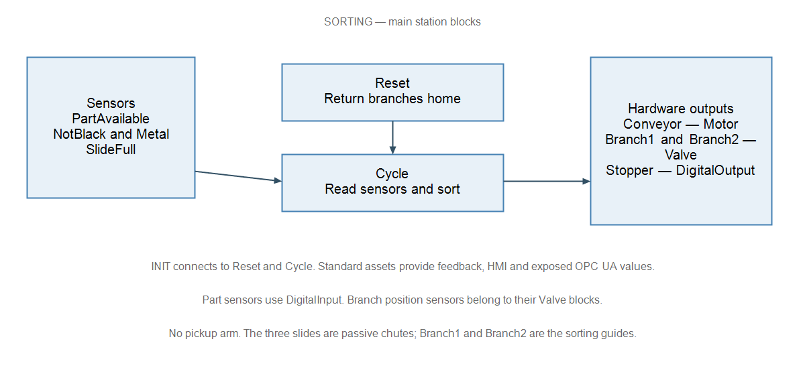
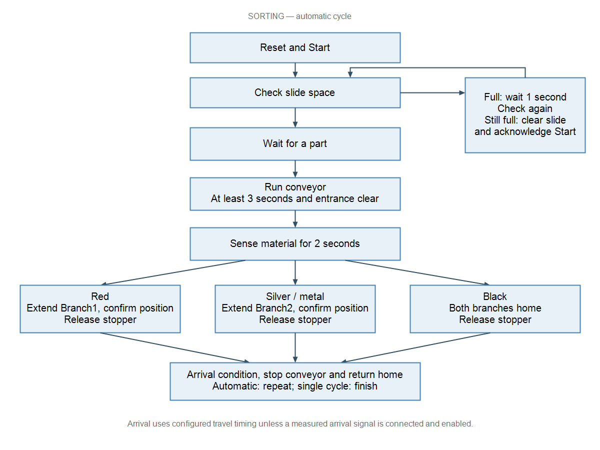

# Converting the Festo sorting station to standard EAE blocks

The Festo sorting GRAFCET in `09_Sorting_GRAFCET.pdf` is converted into an IEC 61499 application in EcoStruxure Automation Expert 25.0.1. The station contains a conveyor, two sorting branches, a stopper and sensors. The main Sorting block groups these physical parts with Reset and Cycle.

## Standard libraries used

| Standard library | Blocks | Sorting function |
|---|---|---|
| SE.App2CommonProcess 25.0.1.5 | Motor | Runs the conveyor. |
| SE.App2CommonProcess 25.0.1.5 | Valve | Moves Branch1 and Branch2 and checks their position feedback. |
| SE.App2CommonProcess 25.0.1.5 | DigitalOutput | Holds or releases the stopper. |
| SE.App2CommonProcess 25.0.1.5 | DigitalInput | Reads part presence, material detection and slide-full sensors. |
| SE.AppSequence 25.0.1.5 | SeqHead, SeqStep, SeqTerminate | Organizes Reset and Cycle into ordered stages and transitions. |
| Runtime.Base 25.0.1.2 | Symbolic-link support | Carries sequence commands and ownership information to the equipment blocks. |

The standard equipment blocks provide reusable command, feedback, alarm and HMI behavior. Small custom helper blocks calculate the sorting conditions and route selection; the application is not entirely standard blocks.

## Converting the sequence

Reset returns the branches to their initial positions. Cycle waits for a part, runs the conveyor for at least three seconds until the entrance clears, then allows two seconds for sensing. Material detection selects Branch1 for red, Branch2 for silver/metal, or the straight route for black. The stopper releases the part, then the station returns home. A full slide causes a one-second recheck and, if still full, waits for the slide to be cleared and Start acknowledged.

*The station-blocks graph shows the hardware, standard assets and Reset/Cycle structure.*

*The auto-cycle graph summarizes the converted Festo sequence and its three sorting routes.*

Physical M251/M580 associations and I/O channels still require commissioning. Arrival uses configured travel timing unless a measured arrival signal is connected and enabled. Operation on the machine has not been verified.

## Testing

The following is a test procedure, using the same format as Distribution. These tests have not been run; the results must be recorded during testing.

### Setup

1. Open `sorting/sorting2n.sln` in EAE 25.0.1 with the libraries listed above. Associate the selected logical device with a compatible local simulation runtime before deployment. The existing unassigned physical-device warning must be resolved first.
2. Build and deploy to that simulation runtime, then open SortingOverview. Use the standard assets' supported Simulation settings and DigitalInput overrides for sensor values. Do not force real machine outputs for these simulation tests.
3. Clear alarms and make the equipment available to Program control before using Reset and Start. Begin with PartAvailable, Metal and SlideFull false, and both branches home. Use single-cycle operation initially. Restore overrides after testing.

| # | Do this | Expect | Result |
|---|---|---|---|
| 1 | **Check the standard assets.** In simulation, select Operator ownership and command Conveyor on/off, Branch1 and Branch2 open/close individually, and Stopper hold/release. Return ownership to Program afterwards. | Commands, simulated feedback and HMI indications agree. Each branch returns home. | Not run |
| 2 | **Reset.** Put the branches away from home, then press Reset. | Reset takes ownership, commands the initial position and waits for both branch-home confirmations. Reset finished is then indicated. | Not run |
| 3 | **Wait and feed.** After Reset, press Start with SlideFull and PartAvailable false. Set PartAvailable true, then false as the part leaves the entrance. | The cycle initially waits. The conveyor then runs; Feed finishes only after at least 3 seconds and entrance-clear feedback. Sensing lasts 2 seconds. | Not run |
| 4 | **Sort red.** During sensing, hold NotBlack true and Metal false. | Branch1 extends and its position is confirmed before the stopper releases. After the arrival condition, the station returns home. | Not run |
| 5 | **Sort silver/metal.** Repeat with NotBlack true and Metal true. | Branch2 extends and its position is confirmed before release. The station then returns home. | Not run |
| 6 | **Sort black.** Repeat with NotBlack false and Metal false. | Both branches remain home and the stopper releases the part along the straight route. The station then completes the cycle. | Not run |
| 7 | **Full slide.** Set SlideFull true before the slide-space check. Leave it true through the 1-second recheck, then clear it and press Start. | The full-slide indication remains active while waiting for acknowledgement. Start returns the sequence to the slide check without requiring Reset. If still full, it waits again. | Not run |
| 8 | **Stop and restart.** Press Stop during a cycle, then Reset before starting again. | The sequence stops, the conveyor is commanded off, the branches are commanded home and the stopper is commanded to hold. Reset must complete before normal operation resumes. | Not run |
| 9 | **Single and automatic operation.** Complete one part in single-cycle mode, then repeat in automatic mode. | Single-cycle operation finishes and waits for Start. Automatic operation returns to the slide-space check and waits for the next part. | Not run |

Use `auto-cycle.png` to follow the stages and `station-blocks.png` to identify the equipment blocks. Record actual results and any alarms against the table. Simulated position feedback does not validate real movement, wiring or timing. Travel-time arrival estimates must be checked on the station, or replaced with measured arrival feedback, before physical operation is accepted.
