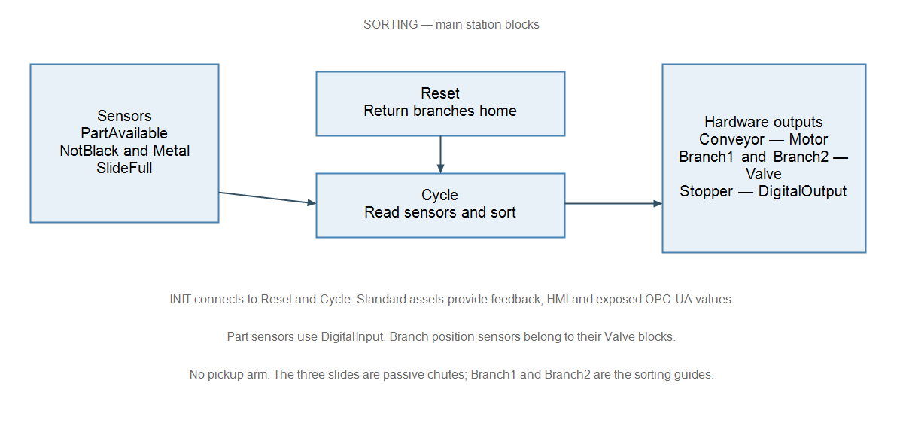
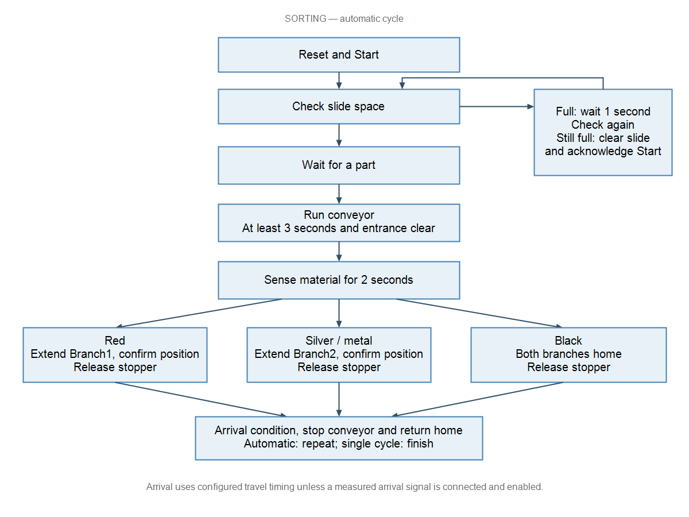

# Converting the Festo sorting station to standard EAE blocks

The Festo sorting GRAFCET in `09_Sorting_GRAFCET.pdf` is converted into an IEC 61499 application in EcoStruxure Automation Expert 25.0.1. The station contains a conveyor, two sorting branches, a stopper and sensors. The main Sorting block groups these physical parts with Reset and Cycle.

## Standard libraries used

| Standard library | Blocks | Sorting function |
|---|---|---|
| SE.App2CommonProcess 25.0.1.5 | Motor | Runs the conveyor. |
| SE.App2CommonProcess 25.0.1.5 | Valve | Moves Branch1 and Branch2 and checks their position feedback. |
| SE.App2CommonProcess 25.0.1.5 | DigitalOutput | Holds or releases the stopper. |
| SE.App2CommonProcess 25.0.1.5 | DigitalInput | Reads part presence, material detection and slide-full sensors. |
| SE.AppSequence 25.0.1.5 | SeqHead, SeqStep, SeqTerminate | Organizes Reset and Cycle into ordered stages and transitions. |
| Runtime.Base 25.0.1.2 | Symbolic-link support | Carries sequence commands and ownership information to the equipment blocks. |

The standard equipment blocks provide reusable command, feedback, alarm and HMI behavior. Small custom helper blocks calculate the sorting conditions and route selection; the application is not entirely standard blocks.

## Converting the sequence

Reset returns the branches to their initial positions. Cycle waits for a part, runs the conveyor for at least three seconds until the entrance clears, then allows two seconds for sensing. Material detection selects Branch1 for red, Branch2 for silver/metal, or the straight route for black. The stopper releases the part, then the station returns home. A full slide causes a one-second recheck and, if still full, waits for the slide to be cleared and Start acknowledged.

*The station-blocks graph shows the hardware, standard assets and Reset/Cycle structure.*

*The auto-cycle graph summarizes the converted Festo sequence and its three sorting routes.*

Physical M251/M580 associations and I/O channels still require commissioning. Arrival uses configured travel timing unless a measured arrival signal is connected and enabled. Operation on the machine has not been verified.
